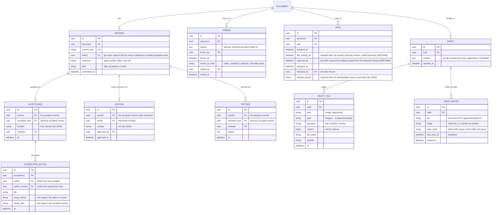
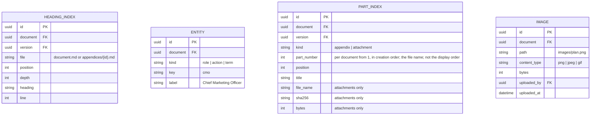
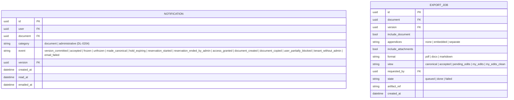

---
tags:
  - technical-design
aliases:
  - Syngraphē data model
status: draft
date: 2026-09-21
---

# Data Model — stage 1

The editor and the exporter (DL-0043, DL-0081). Stage 2 entities are listed at the end as attachment points, so the stage 1 schema has somewhere to put them without migration (ASR-14).

## The rule that shapes everything below

**Git holds content. PostgreSQL holds everything else, and never a second copy of content.** The only content-derived rows are navigation and search indexes, rebuildable from git at any time by replaying the repository. If a table would make git the second source of truth for a document's text, it is wrong.

**Every row says where it came from.** Each table carries `created_at`, `created_by` and an `actor_kind` of `user`, `system` or `agent`; mutable tables add `updated_at` and `updated_by` (DL-0082). `actor_kind` exists because this platform has three kinds of actor, and an agent-written row attributed to a person would be a lie in the audit trail. The columns are omitted from the diagrams below to keep them readable — read them as present on everything.

**Placement follows tenancy** (DL-0029), and the rule is stated per purpose rather than per table so a new table has an answer before it is drawn:

- **Shared schema** — everything that identifies a person or an organisation, that is deliberately cross-cutting, or that is written before any tenant is known: `TENANT`, `USER`, `MEMBERSHIP`, `MEMBERSHIP_HISTORY`, `INVITATION`, `LANGUAGE`, `AUDIT_EVENT`, `SIGN_IN_ATTEMPT`, `ACCOUNT_BLOCK_HISTORY`, `TENANT_STATE_HISTORY`, `USER_PREFERENCE`, `PLATFORM_HOST`, `TENANT_DOMAIN`, the platform's `MAIL_SENDER` and its `EMAIL_OUTBOX` rows. A tenant's own `MAIL_SENDER` and its mail in `EMAIL_OUTBOX` live in the tenant's schema (DL-0203).
- **Tenant schema** — everything scoped to one organisation's documents: every other table in this file.

**`AUDIT_EVENT` is shared, with a nullable tenant**, and that is deliberate. A platform administrator creating a tenant performs an action belonging to no tenant, and an auditor asking *who created this organisation* must not first have to know which schema to look in. The isolation ASR-01 protects is document data; the audit log is cross-cutting by design and reachable only by administrators.

**`MEMBERSHIP_HISTORY`, `INVITATION` and `LANGUAGE` are shared** because each is about the platform-level object beside it: a membership, an email address that is the platform identifier, and a reference list every tenant draws from.

A query that needs a document and a user joins across the boundary deliberately — the boundary is visible in the code that crosses it.

## Platform, shared schema

```mermaid
erDiagram
    TENANT ||--o{ MEMBERSHIP : has
    USER ||--o{ MEMBERSHIP : holds
    USER {
        uuid id PK
        string email UK "platform identifier"
        string display_name "cleared on erasure; identifier kept"
        string password_hash
        bool is_platform_admin
        bool is_tombstoned "former user (DL-0108); the procedure is backlog B-017"
        bool self_blocked "blocks every membership until a platform administrator lifts it"
        datetime last_login_at
        datetime created_at "never exposed to a tenant admin"
    }
    USER ||--o{ INVITATION : invited_by
    INVITATION {
        uuid id PK
        uuid tenant FK
        string email
        string token_hash UK "single use"
        datetime expires_at
        datetime accepted_at
        uuid invited_by FK
    }
    TENANT ||--o{ TENANT_DOMAIN : served_at
    TENANT_DOMAIN {
        uuid id PK
        uuid tenant FK
        string host UK "host name, optional port; set only by a platform administrator (ADR-0008)"
        bool is_default "one per tenant when it has any; builds the links in its emails"
    }
    PLATFORM_HOST {
        uuid id PK
        string host UK "the main set; at least one, 127.0.0.1 out of the box"
        bool is_default "exactly one; builds the links in platform emails"
    }
    EMAIL_OUTBOX {
        uuid id PK
        uuid tenant FK "null for platform mail"
        string sender
        string recipient
        string subject
        text body "number, title, versions, people, event, state, link — never document text or the change summary (DL-0205)"
        string status "queued | sent | failed"
        int attempts "at most 3, five minutes apart (DL-0203)"
        datetime next_attempt_at
        datetime sent_at
        string last_error
        datetime created_at
    }
    TENANT {
        uuid id PK
        string name
        string schema_name UK
        int number UK "platform-wide, in creation order, never reused; names the tenant's directory (ADR-0008)"
        string state "active | blocked; blocked closes it to all but platform administrators"
        bool require_distinct_approver "off by default (DL-0101, DL-0115)"
        int attachment_max_bytes "5 MB by default, tenant administrator sets it (DL-0166)"
        int hold_inactivity_minutes "30 by default, tenant administrator sets it (ADR-0006)"
    }
    MEMBERSHIP {
        uuid id PK
        uuid tenant FK
        uuid user FK
        bool is_tenant_admin
        string state "active | blocked"
        datetime granted_at "what a tenant admin sees"
        uuid granted_by FK
    }
    MEMBERSHIP ||--o{ MEMBERSHIP_HISTORY : records
    MEMBERSHIP_HISTORY {
        uuid id PK
        uuid membership FK
        string field "is_tenant_admin | state"
        string before
        string after
        datetime at
        uuid by FK
        string actor_kind
    }
    USER ||--o{ ACCOUNT_BLOCK_HISTORY : records
    ACCOUNT_BLOCK_HISTORY {
        uuid id PK
        uuid user FK
        string action "self_blocked | unblocked"
        datetime at
        uuid by FK
    }
    TENANT ||--o{ TENANT_STATE_HISTORY : records
    TENANT_STATE_HISTORY {
        uuid id PK
        uuid tenant FK
        string before "active | blocked"
        string after
        datetime at
        uuid by FK
    }
    USER ||--o{ USER_PREFERENCE : keeps
    USER_PREFERENCE {
        uuid id PK
        uuid user FK
        string key "outline_width | panel_width | panel_view | ..."
        string value
    }
    LANGUAGE {
        string code PK "uk | en"
        string label
    }
    AUDIT_EVENT {
        uuid id PK
        uuid tenant FK "null for a platform-level action"
        uuid actor FK "null when the system acted"
        string actor_kind "user | system | agent"
        string action "tenant.created | document.archived | image.uploaded | ..."
        string object_type
        uuid object_id
        json before
        json after
        datetime at
    }
    SIGN_IN_ATTEMPT {
        string key PK "the submitted email address, or the client address"
        string key_kind "email | address"
        int consecutive_failures
        datetime next_allowed_at
        datetime last_failure_at
    }
```

**`SIGN_IN_ATTEMPT` is shared and deliberately keyless to a tenant.** Throttling happens before anyone is identified, so there is no tenant to scope it by; a row exists per submitted address and per client address, is reset on a successful sign-in, and is swept of rows older than a day. It holds no reference to `USER`, because a row must be writable for an address that belongs to nobody — that is exactly the case the identical-response rule exists to hide (T-14).

**There is no self-registration** (DL-0107). A person exists because a tenant administrator invited them; `INVITATION` carries a hashed single-use token with an expiry, and sign-in, password reset and invitation acceptance all answer **identically whether or not an address is known** — they are the classic account-enumeration surfaces, and ASR-17 promises a tenant administrator learns nothing about a person's existence elsewhere.

**`USER.is_tombstoned` is what erasure sets** (DL-0108): display name and email cleared, identifier kept, a *former user* label rendered in their place. Every reference from `created_by`, `ACCESS_CHANGE`, `ACCEPTANCE` and `EDITION` stays valid, so ASR-18 keeps its answers.

**Blocking has three levels** (ADR-0007). A tenant administrator sets `MEMBERSHIP.state` in organisations they administer; a person sets `USER.self_blocked`; a platform administrator sets `TENANT.state`. An active tenant keeps at least one active tenant administrator — the last one may block themselves only as the tenant's last active user — and the last platform administrator can be neither blocked nor demoted. Every block and unblock is typed history — `MEMBERSHIP_HISTORY`, `ACCOUNT_BLOCK_HISTORY`, `TENANT_STATE_HISTORY` — so who could reach what on a past date stays answerable. A platform administrator is notified when a person ends up blocked in some tenants and active in others, and when a tenant is left without an active administrator.

**`MEMBERSHIP.granted_at` is what a tenant administrator sees; `USER.created_at` is not** (ASR-17). Adding a user who already exists elsewhere on the platform must look identical to adding a new one — same screens, same wording, same timestamps. A tenant administrator's block sets `MEMBERSHIP.state`, never anything on `USER`; a person's own block is `USER.self_blocked` (below).

## Documents, tenant schema

```mermaid
erDiagram
    FOLDER ||--o{ FOLDER : contains
    FOLDER ||--o{ DOCUMENT : holds
    DOCUMENT_TYPE ||--o{ DOCUMENT : classifies
    DOCUMENT ||--o{ DOCUMENT_GROUP : linked_to
    ACCESS_GROUP ||--o{ DOCUMENT_GROUP : reaches
    ACCESS_GROUP ||--o{ GROUP_MEMBER : has
    ACCESS_GROUP ||--o{ GROUP_RIGHT : holds
    ACCESS_GROUP ||--o{ ACCESS_CHANGE : records
    DOCUMENT ||--o{ VERSION : has
    DOCUMENT ||--o{ HOLD : locked_by
    DOCUMENT ||--o{ DRAFT : being_edited_as
    DOCUMENT ||--o{ HEADING_INDEX : indexed_by
    DOCUMENT ||--o{ PART_INDEX : lists
    DOCUMENT ||--o{ IMAGE : embeds
    DOCUMENT ||--o{ ENTITY : declares
    DOCUMENT {
        uuid id PK
        int number "per tenant, #7; assigned in creation order, never edited or reused (ADR-0008)"
        string title "cache of document.md frontmatter"
        string language FK "cache of document.md frontmatter"
        uuid document_type FK
        uuid folder FK "required; presentation only; moved by a tenant administrator"
        uuid created_by
        bool author_only "true until the first group is linked (ADR-0007)"
        uuid copied_from FK "source document of a copy; null otherwise"
        datetime created_at
        string state "creating | draft | active | archived"
    }
    DOCUMENT_TYPE {
        uuid id PK
        string code UK "policy | controls | instruction | job_description | notes"
        string label
    }
    FOLDER {
        uuid id PK
        int number "per tenant, root is 1; in URLs (ADR-0008)"
        uuid parent FK "null at root"
        string name
    }
    MAIL_SENDER {
        uuid id PK
        string host
        int port
        string address "the sending address; one per tenant at most (DL-0202)"
        string username
        bytes password_encrypted "authenticated encryption; key from the environment"
        datetime last_test_at
        string last_test_result
    }
    DOCUMENT_TEMPLATE {
        uuid id PK
        text outline "Markdown: section headings, optional starting text"
        bool title_page "whether new documents get a title page"
        text title_page_layout "the export template the title page renders through"
    }
    ACCESS_GROUP {
        uuid id PK
        string name
    }
    GROUP_RIGHT {
        uuid id PK
        uuid group FK
        string right "view_canonical | view_accepted | view_pending | edit | create_and_edit | view_previous_canonical | view_all_history | accept | freeze | make_canonical | reserve_for_editing | create_appendix | delete_appendix | upload_attachment | replace_attachment | delete_attachment"
    }
    GROUP_MEMBER {
        uuid id PK
        uuid group FK
        uuid membership FK
    }
    DOCUMENT_GROUP {
        uuid id PK
        uuid document FK
        uuid group FK
    }
    ACCESS_CHANGE {
        uuid id PK
        string kind "member | right | link"
        uuid group FK
        uuid document FK "for a link"
        uuid membership FK "for a member"
        string right "for a right"
        string action "added | removed"
        datetime at
        uuid by
        string actor_kind
    }
```

**`DOCUMENT.number` is the identity people use and never changes** (ASR-15, ADR-0008) — unique within the tenant, shown as `#7`, and the document's URL. `FOLDER` is presentation; moving a document rewrites one foreign key and nothing in git. **The repository on disk is `tenant-N/document-M/`** (ADR-0008) — `TENANT.number` and `DOCUMENT.number`, never a title; a directory named by title puts document titles, a confidential guidance document's included, into filesystem listings, backup manifests and operator shells that the access table does not govern.

**`creating` is the state that exists because document creation is the one two-store write** (DL-0111): row written `creating`, repository initialised and given its first commit — `document.md` with frontmatter and a body taken from the organisation's `DOCUMENT_TEMPLATE` (DL-0169) — row becomes `draft`. Title, language, the title-page switch and the lists of appendices and attachments live in that frontmatter (DL-0174), which is what lets a repository restored without its row recover them. The reconciler retries a row without a repository and reports a repository without a row as an orphan, never deleting it.

**Groups are the whole permission model** (ADR-0007, ASR-07, ASR-08). A document's `DOCUMENT_GROUP` rows cannot change while a `HOLD` on it is open. A group holds rights (`GROUP_RIGHT`), has members (`GROUP_MEMBER`, through their tenant membership) and is linked to documents (`DOCUMENT_GROUP`); a person's rights on a document are the union of the rights of their groups linked to it. `create_and_edit` is the one right not tied to a link: it lets a member create and copy documents. The part rights apply only where the group can edit. Every right covers a whole document; there is no scope column (DL-0091). Comment is not among the rights; the annotation surface is stage 2 (DL-0083). The group table is `ACCESS_GROUP` so it does not collide with the framework's own.

**`MAIL_SENDER` holds a tenant's own sending address, at most one row** (DL-0202); with none, the platform's sender in the shared schema is used. The password is stored only encrypted and is never read back into the interface.

**`DOCUMENT_TEMPLATE` has one row per tenant in stage 1** (DL-0169): the outline a new document starts from, whether it gets a title page, and the layout the title page renders through at export (DL-0164). The tenant administrator edits it in place; it is configuration, not a document, and has no history beyond `AUDIT_EVENT`.

**A new or copied document is author-only** (ADR-0007): `author_only` is set, no group is linked, and only its creator reaches it, with edit. The tenant administrator is notified and links groups; the first link clears `author_only`, after which the author reaches the document through their groups. A copy records `copied_from`, and an `AUDIT_EVENT` holds the source version's number and commit, visible to administrators. A document with no `accept` holder renders as *no reviewer assigned*, and acceptance is refused with that reason.

**Two audit mechanisms, split by a single question: must the answer be reconstructible at a past date?** (DL-0082)

- **Yes → typed, append-only history.** `MEMBERSHIP_HISTORY` and `ACCESS_CHANGE` — every membership, right and link added or removed — exist so that *"who could read this document on the day that edition was approved"* is a query, not an inference from a replayed event stream.
- **No → `AUDIT_EVENT`.** Everything else a person did and should be answerable for: assigning a document type, attaching a side-document type, archiving, uploading an image. One table, actor and object typed loosely, because nobody reconstructs state from it — they read it.

**Archiving preserves rights rather than removing them** (DL-0084). `DOCUMENT.state` goes to `archived`; its `DOCUMENT_GROUP` links stay, take no effect while it is archived, remain editable by the tenant administrator, and **apply as they then stand** on restore. An archived document enters no analysis scope and is exported only by administrators. Rebuilding a permission set by hand is exactly where a restored document quietly becomes readable by the wrong people. Archiving is visible to tenant and platform administrators only, and an archived document's links stop resolving everywhere — including where its name sits in another document's prose.

## Versions, holds and drafts

**`VERSION.commit_sha` is the join to git**, and the row is a cache of what the commit already says — rebuildable, never authoritative. **`VERSION.author` is the only link between a commit and a person** (DL-0088): git holds the identifier, this table holds the mapping, and nothing personal is in the repository at all. Removing a person's **name and address** from the database therefore anonymises the record without rewriting history — pseudonymisation by construction. It does not remove the person from the record: `created_by`, `ACCESS_CHANGE`, `ACCEPTANCE` and `EDITION` all reference the identifier, and emptying those would destroy the audit answers ASR-18 promises. The erasure shape is a **tombstone** — identifier kept, name and address gone, a *former user* label in their place — settled at DL-0108.

**`CORRECTION_NOTICE` is generated, never authored** (DL-0102, ADR-0001), and it **holds references, not text** (DL-0113). Both wordings are rendered from git when the notice is opened, under the reader's **current** rights — a stored copy would survive a revoked right and an archived document, and would escape the access table entirely, since a notice is read through the notification surface. In stage 2 it becomes the durable rejection record and gains an escalation path; the table is its first form, not a placeholder.

**`RETURN` is the other reviewer decision, and it is a commit** (DL-0114). Returning a run without accepting it writes the passport exactly as an acceptance does, so the review history needs no second system to be believed and an export shows it. The derived row gives the document list what it needs to say *returned to its authors* rather than *awaiting review*. The next send for review presents the whole run since the last acceptance, returned versions included.

**`TENANT.require_distinct_approver`** enforces the one optional segregation check: when set, `EDITION.approved_by` may not be the reviewer of **any** `ACCEPTANCE` between the previous canonical edition and this one (DL-0101, DL-0115). Not merely the last — accept a substantive run yourself, have a colleague accept a following run that changes a comma, and *last* stops meaning anything.

**Version numbers are derived, never typed** (DL-0183). Each acceptance is numbered `N.M`: N is the count of canonical editions before it, M counts acceptances since the last one and restarts at 1 — so 0.1, 0.2 before the first canonical edition. Making a frozen document canonical turns its latest accepted version into `N+1.0`; unfreezing changes no number. Numbers are written into the passport with the acceptance and the approval, so the repository carries them; these columns are caches. Unfreezing changes no number.

**A freeze is a state of the document, an edition is a canonical version** (DL-0189). A `FREEZE` row with no `ended_at` means the document is frozen: only holders of both *accept* and *edit* may open an editor. It ends by *make canonical*, which writes an `EDITION` for the latest accepted version, or by *unfreeze*. The three stances fall out of these tables without a state column anywhere: canonical is the latest `EDITION`; accepted is the latest `ACCEPTANCE`; pending is every `VERSION` after it.

**A reservation is a mark on `HOLD`, not a table** (ADR-0009, DL-0221). `reserved_at` set means the hold is exempt from the inactivity release; cancelling clears it and sets `last_activity_at` to that moment, so the inactivity clock starts afresh. It is set only by a holder whose group linked to the document holds both `reserve_for_editing` and `edit`, and never while a `FREEZE` is open. As for any open hold, freezing, `DOCUMENT_GROUP` changes and correction are refused; while it is set, acceptance and return by anyone else are refused as well — the holder's own *accept as N.M* ends the reservation in the same act. Starting, cancelling and ending a reservation each write an `AUDIT_EVENT`, so the record keeps every reservation after `reserved_at` is cleared (DL-0221). An administrator ending it also records `released_by` and `release_reason`, puts the draft's state in that event, and notifies the holder (`reservation_ended_by_admin`); starting one notifies the tenant administrator (`reservation_started`).

**`DRAFT` hangs off `HOLD`, not off `DOCUMENT`.** Releasing a hold — voluntarily or after the inactivity timeout — preserves the draft rather than discarding it (ADR-0003), and the foreign key is what makes that automatic rather than remembered.

**`DRAFT_FILE` holds uploads until they are committed** (DL-0175). An image or attachment added, replaced or removed during a hold waits here, under the same point-in-time recovery as the draft's text, and is written to the repository by the commit that finishes the session. It is the first copy of that content, not a second one.

**`OPEN_EDITOR` is what makes several editors safe** (DL-0167). A capture is accepted only while its range of the draft still hashes to `base_hash`; an editor with no heartbeat past the timeout is closed; finishing is refused while any row is open.

## Content index, entities, images

**`HEADING_INDEX` is a cache and says so** — rebuilt by parsing `document.md` and each appendix at a version, and it exists only to drive the outline, the section editors and the rendered numbering. A row is valid for one version and rebuilt for the next.

**Appendices and attachments are numbered per document from 1** in creation order (ADR-0008); the number names the file, appears in the part's URL, and never changes when parts are reordered.

**`PART_INDEX` is the same kind of cache** over the frontmatter's lists of appendices and attachments (DL-0174), so a document page can list its parts without reading git. Git is the authority; the rows are rebuilt per version.

**There is no paragraph table, and that is deliberate.** Clause numbers are rendered labels derived from depth (DL-0065), and anything that must point at a passage — a finding, and later a comment — anchors with W3C text-quote selectors (DL-0027). Storing paragraph identifiers would put structure in two places and make every edit a reconciliation.

**Comments are not here.** Threads, anchors and resolution are a surface rather than a field, and the whole of it is stage 2 (DL-0083).

**`ENTITY` mirrors `entities.yaml` for lookup.** Occurrences are the attributed spans in the text and are not stored: the role directory is produced by parsing the sections at a version (DL-0073), which is why it ships in stage 1 without an agent.

## Notifications and export

**`EMAIL_OUTBOX` is written before any attempt to send** (DL-0203): three attempts five minutes apart, then *failed* and an in-application notification to the tenant's and the platform's administrators. It is also the log of every email sent. With no sender configured, nothing is queued.

**`NOTIFICATION.emailed_at` separates the two surfaces**: the in-application record exists whether or not mail was sent. The platform's sender is one row in the shared schema, a tenant's own sender one row in its schema; each password is encrypted at rest and write-only in the interface (DL-0072, DL-0202).

**`EXPORT_JOB.version` is required**, not defaulted to the latest. An export is of a stated version — usually the canonical edition — and a job that silently followed the head would produce documents nobody can reproduce. What, format and view are the three choices the export screen composes (DL-0172, DL-0193); a *my edits* export reads the requester's own draft as well as the version.

## Stage 2 attachment points

Not built now; the tables above must leave room for them without a migration that rewrites document, version or acceptance records (ASR-14).

| Entity | Attaches to | Note |
|---|---|---|
| `HEURISTIC`, `COMPANION_ACTION`, `SIDE_DOCUMENT_TYPE` | shared schema, assigned per document | platform-authored; the tenant attaches, never authors (DL-0049) |
| `ANALYSIS_RUN` | keyed by review scope and content state | scope is a set of documents the reviewer selects (DL-0077, DL-0078) |
| `FINDING` | `ANALYSIS_RUN`, anchored by text-quote selector | carries provenance tags; audience computed per recipient (DL-0021) |
| `REVIEW_SCOPE` | a reviewer and a set of documents | the unit an analysis is keyed to |
| `GENERATED_VIEW` | `DOCUMENT`, one row per view type | mandatory views recompile per commit; voluntary on request (DL-0063) |
| `DOCUMENT_ADR` | `DOCUMENT`, many versions | generated on a logic change, editable by a person (DL-0045) |
| `DISPUTE`, `REJECTION_RECORD` | `VERSION` | deferred entirely to stage 2 (DL-0076) |
| `THREAD`, `COMMENT` | `DOCUMENT`, anchored by text-quote selector | the annotation surface, deferred (DL-0083) |

**The one thing stage 1 must get right for stage 2** is that `VERSION` is addressable and immutable, and that anchors are text-selectors rather than positions. Everything above hangs off those two facts.

## What is deliberately absent

- **No paragraph table** — see above.
- **No section content table** — git holds it.
- **No per-user analysis folder** — analyses key to scope, not person (DL-0078).
- **No comment tables** — stage 2 (DL-0083).
- **No per-person document rights** — rights are held by groups (ADR-0007); the author's access before the first link is a flag on the document, not a row.
- **No scope column anywhere** — rights and holds are whole-document (DL-0091).
- **No partial-approval tables** — acceptance is a document act (DL-0090).
- **No `state` column on `DOCUMENT` for the review cycle** — the stances are derived from `ACCEPTANCE` and `EDITION`, so there is no second place for them to disagree.
- **No cross-tenant table of any kind** (ASR-17).
- **No document text in any notification or notice row** (DL-0113) — references only, rendered from git under current rights.
- **No normalizer version on the document** — it is recorded per commit (DL-0112).
