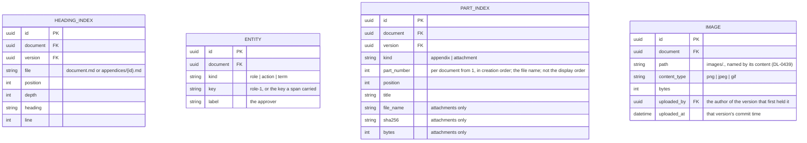
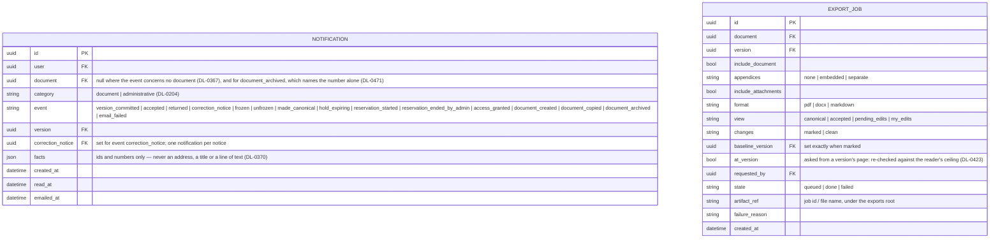

---
tags:
  - technical-design
aliases:
  - Syngraphē data model
status: draft
date: 2026-09-21
---

# Data Model — stage 1

The editor and the exporter (DL-0043, DL-0081). Stage 2 entities are listed at the end as attachment points, so the stage 1 schema has somewhere to put them without migration (ASR-14).

## The rule that shapes everything below

**Git holds content. PostgreSQL holds everything else, and never a second copy of content.** The only content-derived rows are navigation and search indexes and the per-line authorship cache (`LINE_AUTHORSHIP`), all rebuildable from git at any time by replaying the repository. If a table would make git the second source of truth for a document's text, it is wrong.

**Every row says where it came from.** Each table carries `created_at`, `created_by` and an `actor_kind` of `user`, `system` or `agent`; mutable tables add `updated_at` and `updated_by` (DL-0082). `actor_kind` exists because this platform has three kinds of actor, and an agent-written row attributed to a person would be a lie in the audit trail. The columns are omitted from the diagrams below to keep them readable — read them as present on every table except those that are themselves the record of one act — the histories and `AUDIT_EVENT`, which carry their own timestamp and actor — three that are state without provenance: `SIGN_IN_ATTEMPT`, a counter no person writes, `SETUP_TOKEN`, written by the install command, and `PASSWORD_RESET`, written for whoever asks at the sign-in page, before anyone is known — swept a day after it is used or expires (DL-0413); the editing tables `HOLD`, `DRAFT`, `DRAFT_FILE` and `OPEN_EDITOR`, whose own columns say who and when; and `LINE_AUTHORSHIP`, a cache the worker derives from git, whose provenance is the commit it names.

**Placement follows tenancy** (DL-0029), and the rule is stated per purpose rather than per table so a new table has an answer before it is drawn:

- **Shared schema** — everything that identifies a person or an organisation, that is deliberately cross-cutting, or that is written before any tenant is known: `TENANT`, `USER`, `MEMBERSHIP`, `MEMBERSHIP_HISTORY`, `INVITATION`, `PASSWORD_RESET`, `LANGUAGE`, `AUDIT_EVENT`, `SIGN_IN_ATTEMPT`, `ACCOUNT_BLOCK_HISTORY`, `TENANT_STATE_HISTORY`, `USER_PREFERENCE`, `PLATFORM_HOST`, `TENANT_DOMAIN`, `SETUP_TOKEN`, `PLATFORM_NOTIFICATION`, the platform's `MAIL_SENDER` and its `EMAIL_OUTBOX` rows. A tenant's own `MAIL_SENDER` and its mail in `EMAIL_OUTBOX` live in the tenant's schema (DL-0203), so those two tables exist in both: the `mail` app is on both the shared and the tenant list, and a query reaches the tenant's rows when a tenant is set and the platform's only with the shared schema alone (ADR-0017). A person's `NOTIFICATION` lives in the tenant's schema, a platform administrator's `PLATFORM_NOTIFICATION` in the shared one (DL-0382). A reset's email is queued where DL-0383 places it — on an organisation's domain, that organisation's outbox; on the platform host, the outbox of the person's one active membership, else the shared one — and an organisation's outbox page leaves resets out (DL-0410).
- **Tenant schema** — everything scoped to one organisation's documents: every other table in this file.

**`AUDIT_EVENT` is shared, with a nullable tenant**, and that is deliberate. A platform administrator creating a tenant performs an action belonging to no tenant, and an auditor asking *who created this organisation* must not first have to know which schema to look in. The isolation ASR-01 protects is document data; the audit log is cross-cutting by design and reachable only by administrators.

**`MEMBERSHIP_HISTORY`, `INVITATION`, `PASSWORD_RESET` and `LANGUAGE` are shared** because each is about the platform-level object beside it: a membership, an email address that is the platform identifier, a person, and a reference list every tenant draws from.

**The first-run setup token is one row in the shared schema** — its hash and expiry, deleted when used and ignored once expired (DL-0231, T-19). Using it is an `AUDIT_EVENT`. Once a platform administrator exists there is no row, and the first-run page answers as not found.

A query that needs a document and a user joins across the boundary deliberately — the boundary is visible in the code that crosses it.

## Platform, shared schema

```mermaid
erDiagram
    TENANT ||--o{ MEMBERSHIP : has
    USER ||--o{ MEMBERSHIP : holds
    USER {
        uuid id PK
        string email UK "platform identifier"
        string display_name "cleared on erasure; identifier kept"
        string password_hash
        bool is_platform_admin
        bool is_tombstoned "former user (DL-0108); the procedure is backlog B-017"
        bool self_blocked "blocks every membership; no control lifts it in release 0.1 (DL-0254)"
        bool is_superuser "operator of the framework's own interface (DL-0210); set from the command line, never by the application"
        datetime last_login_at
        datetime created_at "never exposed to a tenant admin"
    }
    USER ||--o{ INVITATION : invited_by
    INVITATION {
        uuid id PK
        uuid tenant FK
        string email
        string token_hash UK "single use"
        datetime expires_at
        datetime accepted_at
        uuid invited_by FK "domain field: who sent this invitation"
        uuid created_by FK "provenance: the same administrator, as every row records its writer"
    }
    USER ||--o{ PASSWORD_RESET : asked_for
    PASSWORD_RESET {
        uuid id PK
        uuid user FK
        string token_hash UK "single use"
        datetime expires_at "one hour (DL-0373)"
        datetime used_at
        datetime created_at
    }
    TENANT ||--o{ TENANT_DOMAIN : served_at
    TENANT_DOMAIN {
        uuid id PK
        uuid tenant FK
        string host UK "host name, optional port; set only by a platform administrator (ADR-0008)"
        bool is_default "one per tenant when it has any; builds the links in its emails"
    }
    PLATFORM_HOST {
        uuid id PK
        string host UK "the main set; at least one, 127.0.0.1 out of the box"
        bool is_default "exactly one; builds the links in platform emails"
    }
    SETUP_TOKEN {
        uuid id PK
        string token_hash UK "single use"
        datetime expires_at
    }
    EMAIL_OUTBOX {
        uuid id PK
        uuid tenant FK "null for platform mail"
        string sender "the address it left from"
        string recipient
        string subject
        text body "number, title, versions, people, event, state, link — never document text or the change summary (DL-0205); a credential link's token replaced once sent or failed (DL-0406)"
        string status "queued | sent | failed"
        int attempts "refusals so far; failed at the third, five minutes apart (DL-0203)"
        datetime next_attempt_at
        datetime sent_at
        string last_error "a reason code and the server's answer, never an exception's text"
        datetime created_at
        uuid notification_id "the notification it carries, of the same schema; no constraint, since neither notification table is in both"
        string kind "notification | invitation | reset; a reset is left out of an organisation's outbox page (DL-0410)"
    }
    USER ||--o{ PLATFORM_NOTIFICATION : told
    PLATFORM_NOTIFICATION {
        uuid id PK
        uuid user FK "a platform administrator"
        string event "backup_condition | email_failed | user_partially_blocked | tenant_without_admin (DL-0367, DL-0382)"
        json facts "ids and numbers only (DL-0370)"
        datetime created_at
        datetime read_at
        datetime emailed_at
    }
    TENANT {
        uuid id PK
        string name
        string schema_name UK
        int number UK "platform-wide, in creation order, never reused; names the tenant's directory (ADR-0008)"
        string state "migrating | active | blocked; migrating until its schema is fully migrated, resolvable by no request (ADR-0017); blocked closes it to all but platform administrators"
        bool require_distinct_approver "off by default (DL-0101, DL-0115)"
        int attachment_max_bytes "5 MB by default, tenant administrator sets it (DL-0166)"
        int hold_inactivity_minutes "30 by default, tenant administrator sets it (ADR-0006)"
    }
    MEMBERSHIP {
        uuid id PK
        uuid tenant FK
        uuid user FK
        bool is_tenant_admin
        string state "active | blocked"
        datetime granted_at "what a tenant admin sees"
        uuid granted_by FK
    }
    MEMBERSHIP ||--o{ MEMBERSHIP_HISTORY : records
    MEMBERSHIP_HISTORY {
        uuid id PK
        uuid membership FK
        string field "is_tenant_admin | state"
        string before
        string after
        datetime at
        uuid by FK
        string actor_kind
    }
    USER ||--o{ ACCOUNT_BLOCK_HISTORY : records
    ACCOUNT_BLOCK_HISTORY {
        uuid id PK
        uuid user FK
        string action "self_blocked | block_lifted"
        datetime at
        uuid by FK
    }
    TENANT ||--o{ TENANT_STATE_HISTORY : records
    TENANT_STATE_HISTORY {
        uuid id PK
        uuid tenant FK
        string before "migrating | active | blocked"
        string after
        datetime at
        uuid by FK "null when migrate_schemas activates a migrating tenant (DL-0280)"
    }
    USER ||--o{ USER_PREFERENCE : keeps
    USER_PREFERENCE {
        uuid id PK
        uuid user FK
        string key "show_author | outline_width | panel_width | panel_view | ..."
        string value
    }
    LANGUAGE {
        string code PK "uk | en"
        string label
        string never_final "abbreviations a stop after which never ends a sentence; one per line; seeded from the repository (ADR-0012)"
        string may_be_final "abbreviations a stop after which ends a sentence only before a capitalised word; one per line; seeded from the repository (ADR-0012)"
    }
    AUDIT_EVENT {
        uuid id PK
        uuid tenant FK "null for a platform-level action"
        uuid actor FK "null when the system acted"
        string actor_kind "user | system | agent"
        string action "tenant.created | document.archived | image.uploaded | entity.declared | ..."
        string object_type
        uuid object_id
        json before
        json after
        datetime at
    }
    SIGN_IN_ATTEMPT {
        string key PK "the client address; a hash of the address typed and the client; a device's; or a hash of a reset request's client"
        string key_kind "address | pair | device | reset"
        int consecutive_failures
        datetime next_allowed_at
        datetime last_failure_at
    }
```

**`SIGN_IN_ATTEMPT` is shared and deliberately keyless to a tenant.** Throttling happens before anyone is identified, so there is no tenant to scope it by; a row exists per client address and per pair of address typed and client — hashed, so the address typed is never stored — a browser that signed in before is counted on its device's row alone (DL-0293); the pair's or the device's row is reset on a successful sign-in, and rows older than a day are swept (DL-0289). It holds no reference to `USER`, because a row must be writable for an address that belongs to nobody — that is exactly the case the identical-response rule exists to hide (T-14). A reset request is counted on a `reset` row per client, a key apart from the client's sign-in row, never settled by a success (DL-0408).

**There is no self-registration** (DL-0107). A person exists because a tenant administrator invited them; `INVITATION` carries a hashed single-use token with a seven-day expiry, and sign-in, password reset and invitation acceptance all answer **identically whether or not an address is known** — they are the classic account-enumeration surfaces, and ASR-17 promises a tenant administrator learns nothing about a person's existence elsewhere. **An invitation creates the person and the membership at once** (DL-0374): a new address becomes a `USER` with no usable password, and both cases get their `MEMBERSHIP` with `granted_at` by the same clock; the link sets the password. Inviting again ends the organisation's earlier open invitation; spending any link — an invitation's or a reset's — ends every other open link to the person. A reset is a `PASSWORD_RESET` row, its token hashed, one hour long (DL-0373).

**`USER.is_tombstoned` is what erasure sets** (DL-0108): display name and email cleared, identifier kept, a *former user* label rendered in their place. Every reference from `created_by`, `ACCESS_CHANGE`, `ACCEPTANCE` and `EDITION` stays valid, so ASR-18 keeps its answers.

**Blocking has three levels** (ADR-0007). A tenant administrator sets `MEMBERSHIP.state` in organisations they administer; a person sets `USER.self_blocked`; a platform administrator sets `TENANT.state`. An active tenant keeps at least one active tenant administrator, memberships counted by their own state (DL-0409) — the last one may block themselves only as the tenant's last active user — and the last platform administrator can be neither blocked nor demoted. **An organisation's pages show a membership's own state and never a person's own block** (DL-0398): a self-blocked person's membership reads *active*, and its administrators may block and lift it, which changes the membership alone. A block of any level ends the holds and reservations it closes to the person (DL-0256), a membership's block ends the organisation's open invitations to the person, and an organisation's block all of its open invitations. Every block and every lifting of one is typed history — `MEMBERSHIP_HISTORY`, `ACCOUNT_BLOCK_HISTORY`, `TENANT_STATE_HISTORY` — so who could reach what on a past date stays answerable. A platform administrator is notified when a person ends up blocked in some tenants and active in others, and when a tenant is left without an active administrator.

**A tenant is `migrating` until its schema is complete** (ADR-0017). Its row is written before its schema is created and migrated; no request resolves it in that state; it becomes `active` only when its migrations have all run — in the act that creates it, or later, when `migrate_schemas` completes a schema a crash or a failed migration left half-made.

**`MEMBERSHIP.granted_at` is what a tenant administrator sees; `USER.created_at` is not** (ASR-17). Adding a user who already exists elsewhere on the platform must look identical to adding a new one — same screens, same wording, same timestamps. A tenant administrator's block sets `MEMBERSHIP.state`, never anything on `USER`; a person's own block is `USER.self_blocked` (below).

## Documents, tenant schema

```mermaid
erDiagram
    FOLDER ||--o{ FOLDER : contains
    FOLDER ||--o{ DOCUMENT : holds
    DOCUMENT_TYPE ||--o{ DOCUMENT : classifies
    DOCUMENT ||--o{ DOCUMENT_GROUP : linked_to
    ACCESS_GROUP ||--o{ DOCUMENT_GROUP : reaches
    ACCESS_GROUP ||--o{ GROUP_MEMBER : has
    ACCESS_GROUP ||--o{ GROUP_RIGHT : holds
    ACCESS_GROUP ||--o{ ACCESS_CHANGE : records
    DOCUMENT ||--o{ VERSION : has
    DOCUMENT ||--o{ HOLD : held_by
    DOCUMENT ||--o{ HEADING_INDEX : indexed_by
    DOCUMENT ||--o{ PART_INDEX : lists
    DOCUMENT ||--o{ IMAGE : embeds
    DOCUMENT ||--o{ ENTITY : declares
    DOCUMENT {
        uuid id PK
        int number "per tenant, #7; assigned in creation order, never edited or reused (ADR-0008)"
        string title "cache of document.md frontmatter"
        string language FK "cache of document.md frontmatter"
        uuid document_type FK
        uuid folder FK "required; presentation only; moved by a tenant administrator"
        uuid created_by
        bool author_only "true until the first group is linked (ADR-0007)"
        uuid copied_from FK "source document of a copy; null otherwise"
        datetime created_at
        string state "creating | active | archived"
    }
    DOCUMENT_TYPE {
        uuid id PK
        string code UK "per tenant; seeded with document, which is renamed or retired, never deleted (DL-0235, DL-10-002)"
        datetime retired_at "set when retired; a type still assigned is retired, never deleted; the last type not retired is neither (DL-10-001)"
        string label "one printable line of 1 to 100 characters, unique among the tenant's types in any case, retired ones included (DL-10-001)"
    }
    FOLDER {
        uuid id PK
        int number "per tenant, root is 1, the others from a sequence starting at 2; in URLs (ADR-0008)"
        uuid parent FK "null at the root alone"
        string name "one printable line of 1 to 200 characters, unique among its siblings in any case (DL-0453); the root's is empty, drawn as the tenant's name, never edited"
    }
    MAIL_SENDER {
        uuid id PK
        string host
        int port
        string address "the sending address; one per schema at most (DL-0202)"
        string display_name "the sender's name in the From line, optional"
        string username "empty: no sign-in"
        bytes password_encrypted "authenticated encryption; key from the environment (DL-0384)"
        string security "starttls | tls | none (DL-0371); sign-in without encryption only to the same machine (DL-0388)"
        datetime last_test_requested_at "one test at a time (DL-0392)"
        datetime last_test_at
        string last_test_result "each step's outcome"
    }
    DOCUMENT_TEMPLATE {
        uuid id PK
        text outline "Markdown: section headings, optional starting text; at most 20,000 bytes"
        bool title_page "whether new documents get a title page"
        text title_page_layout "which details the title page shows, in which order, aligned how; empty for the default form (DL-0462); among them the document's own title-page text, kept in its frontmatter (DL-0476)"
    }
    ACCESS_GROUP {
        uuid id PK
        string name
    }
    GROUP_RIGHT {
        uuid id PK
        uuid group FK
        string right "view_canonical | view_accepted | view_pending | edit | create_and_edit | view_previous_canonical | view_all_history | accept | freeze | make_canonical | reserve_for_editing | create_appendix | delete_appendix | upload_attachment | replace_attachment | delete_attachment"
    }
    GROUP_MEMBER {
        uuid id PK
        uuid group FK
        uuid membership FK
    }
    DOCUMENT_GROUP {
        uuid id PK
        uuid document FK
        uuid group FK
    }
    ACCESS_CHANGE {
        uuid id PK
        string kind "member | right | link"
        uuid group FK
        uuid document FK "for a link"
        uuid membership FK "for a member"
        string right "for a right"
        string action "added | removed"
        datetime at
        uuid by
        string actor_kind
    }
```

**`DOCUMENT.number` is the identity people use and never changes** (ASR-15, ADR-0008) — unique within the tenant, shown as `#7`, and the document's URL. `FOLDER` is presentation; moving a document rewrites one foreign key and nothing in git. **The repository on disk is `tenant-N/document-M/`** (ADR-0008) — `TENANT.number` and `DOCUMENT.number`, never a title; a directory named by title puts document titles, a confidential guidance document's included, into filesystem listings, backup manifests and operator shells that the access table does not govern.

**`creating` is the state that exists because document creation is the one two-store write** (DL-0111): row written `creating`, repository initialised and given its first commit — `document.md` with frontmatter and a body taken from the organisation's `DOCUMENT_TEMPLATE` (DL-0169) — row becomes `active`; that it reaches only its author is `author_only`, not a state (DL-0260). Title, language, the title-page switch and the lists of appendices and attachments live in that frontmatter (DL-0174), which is what lets a repository restored without its row recover them. The reconciler finishes a creation that stopped — except a copy, whose source the audit trail names before its repository is touched: a stopped copy is left unfinished and reported, and the operator removes it (DL-0455) — and recreates the row of a repository without one, with no access, never deleting a repository.

**Groups are the whole permission model** (ADR-0007, ASR-07, ASR-08). A document's `DOCUMENT_GROUP` rows cannot change while a `HOLD` on it is open. A group holds rights (`GROUP_RIGHT`), has members (`GROUP_MEMBER`, through their tenant membership) and is linked to documents (`DOCUMENT_GROUP`); a person's rights on a document are the union of the rights of their groups linked to it. `create_and_edit` is the one right not tied to a link: it lets a member create and copy documents. The part rights apply only where the group can edit. *Accept*, *freeze* and *reserve_for_editing* include *edit* and the views below it, *make_canonical* includes *view_accepted* — an included right is implied, not stored (ADR-0016, DL-0234). Every right covers a whole document; there is no scope column (DL-0091). Comment is not among the rights; the annotation surface is stage 2 (DL-0083). The group table is `ACCESS_GROUP` so it does not collide with the framework's own.

**`MAIL_SENDER` holds a tenant's own sending address, at most one row** (DL-0202); with none, the platform's sender in the shared schema is used. The password is stored only encrypted and is never read back into the interface.

**`DOCUMENT_TEMPLATE` has one row per tenant in stage 1** (DL-0169): the outline a new document starts from — at most 20,000 bytes (DL-0481), put in normal form for the new document's language at its first commit — whether it gets a title page, and the layout the title page renders through at export (DL-0164). The tenant administrator edits it in place; it is configuration, not a document, and has no history beyond `AUDIT_EVENT`.

**A new or copied document is author-only** (ADR-0007): `author_only` is set, no group is linked, and only its creator reaches it, with edit. The tenant administrator is notified and links groups; the first link clears `author_only`, after which the author reaches the document through their groups. A copy records `copied_from`, and its `document.copied` `AUDIT_EVENT` — written before its repository exists — holds the source's number, the version's number and commit and the appendices taken; the copy's *Info* tab shows administrators the source, the version and the commit, with when and by whom it was copied (DL-0455). A document with no `accept` holder renders as *no reviewer assigned*, and acceptance is refused with that reason.

**Two audit mechanisms, split by a single question: must the answer be reconstructible at a past date?** (DL-0082)

- **Yes → typed, append-only history.** `MEMBERSHIP_HISTORY` and `ACCESS_CHANGE` — every membership, right and link added or removed — exist so that *"who could read this document on the day that edition was approved"* is a query, not an inference from a replayed event stream.
- **No → `AUDIT_EVENT`.** Everything else a person did and should be answerable for: assigning a document type, attaching a side-document type, archiving, uploading an image. One table, actor and object typed loosely, because nobody reconstructs state from it — they read it.

**Archiving preserves rights rather than removing them** (DL-0084). `DOCUMENT.state` goes to `archived`; its `DOCUMENT_GROUP` links stay, take no effect while it is archived, remain editable by the tenant administrator, and **apply as they then stand** on restore. An archived document enters no analysis scope and is exported only by administrators. Rebuilding a permission set by hand is exactly where a restored document quietly becomes readable by the wrong people. Archiving is visible to tenant and platform administrators only, and an archived document's links stop resolving everywhere — including where its name sits in another document's prose.

## Versions, holds and drafts

```mermaid
erDiagram
    DOCUMENT ||--o{ VERSION : has
    VERSION ||--o| ACCEPTANCE : accepted_by
    VERSION ||--o| EDITION : made_canonical_as
    DOCUMENT ||--o{ FREEZE : frozen_by
    DOCUMENT ||--o{ HOLD : held_by
    HOLD ||--o| DRAFT : drafted_in
    VERSION ||--o{ LINE_AUTHORSHIP : attributed_in
    VERSION {
        uuid id PK
        uuid document FK
        string commit_sha UK
        uuid author FK "git author name is this id; email is {id}@users.noreply.syngraphe.local"
        string summary "starts from a mechanical draft naming the sections touched; the author edits it (DL-0261); agent-drafted from 0.2"
        string kind "created | edit | reviewer_edit | acceptance | return | approval — created: the first commit of a new or copied document (DL-0268); reviewer_edit: a content version committed by a holder of accept (ADR-0014); the last three are passport commits (DL-0260)"
        datetime committed_at
    }
    ACCEPTANCE {
        uuid id PK
        uuid version FK "the passport commit"
        uuid accepted_from FK "previous accepted version"
        string number "N.M, derived (DL-0183)"
        uuid reviewer FK
        datetime at
        datetime notices_computed_at "set with its correction notices; null until computed, so an acceptance with no notices is told from one not yet computed"
    }
    ACCEPTANCE ||--o{ CORRECTION_NOTICE : generates
    CORRECTION_NOTICE {
        uuid id PK
        uuid acceptance FK
        uuid author FK "whose lines were changed; one notice per author per acceptance (ADR-0014)"
        datetime at
    }
    CORRECTION_NOTICE ||--|{ CORRECTION_LINE : lists
    CORRECTION_LINE {
        uuid id PK
        uuid notice FK
        uuid changing_version FK "a reviewer_edit version of the run, or the acceptor's own version; its author is who changed it (ADR-0014)"
        string entry "line | restored | part_operation — a line the author wrote, a line the author removed that was restored, an appendix or attachment operation reverted"
        string part "the appendix or attachment, for a part operation: its path beside document.md; empty for a line"
        uuid author_version FK "the version that wrote the line, or, for restored, the version that removed it; render the original from here, or from its parent for restored"
        string file
        string range_before "line range in the author's version, or in its parent for restored"
        string range_after "line range in the accepted version; empty for a removal"
    }
    VERSION ||--o{ RETURN : returned_by
    RETURN {
        uuid id PK
        uuid version FK "the passport commit"
        uuid returned_from FK "previous accepted version"
        uuid reviewer FK
        text reason "required: one line, at most 500 characters, no bidirectional controls (DL-0378)"
        datetime at
    }
    FREEZE {
        uuid id PK
        uuid document FK
        text reason "optional: what the document waits for — one line, at most 500 characters (DL-0353)"
        uuid frozen_by FK
        datetime frozen_at
        string ended_by_kind "made_canonical | unfrozen; empty while active"
        uuid ended_by FK "empty when an operator ended it"
        datetime ended_at
    }
    EDITION {
        uuid id PK
        uuid version FK "the accepted version made canonical"
        uuid approval_version FK "the passport commit that records the approval, tagged (DL-0260)"
        uuid freeze FK "the freeze it ended"
        string number "N.0 (DL-0183)"
        uuid approved_by FK
        datetime approved_at
    }
    HOLD {
        uuid id PK
        uuid document FK
        uuid user FK
        datetime acquired_at
        datetime last_activity_at "released after the tenant's inactivity timeout, unless reserved (ADR-0006)"
        datetime reserved_at "set while reserved for editing; exempt from the inactivity release (ADR-0009)"
        datetime released_at
        uuid released_by FK "the administrator who forced it; the blocking administrator when blocked; null for a finish, a discard, an inactivity release, a self-block, or a release forced from the operator's command"
        string release_kind "finished | accepting | discarded | inactivity | forced | blocked — blocked when the holder's membership, account or tenant is blocked (DL-0256); accepting while an *accept as* has its version and not yet its acceptance (DL-0397); finished also when another's release completes a finish that stopped after its commit, the actor in the audit (DL-0414)"
        string release_reason "required when an administrator ends a reservation (DL-0225)"
    }
    LINE_AUTHORSHIP {
        uuid id PK
        uuid version FK "kept for the head and the latest accepted version; older versions computed on demand (DL-0266)"
        string file
        int line
        uuid introduced_by FK "the version that introduced the line"
        bool ambiguous_move "a verbatim line matched more than once; recorded, not guessed (ADR-0011)"
        datetime expires_at "null for the kept versions; set on rows computed on demand"
    }
    DRAFT {
        uuid id PK
        uuid hold FK
        string base_commit "the head's commit when the hold was taken (DL-0318)"
        json content "per-file working text: body, each listed appendix under appendices/<n>.md, frontmatter with its lists, entities.yaml (the head's when the hold was taken, and every declaration made since); after a reviewer's revert, revert: each part put back, with the head it was taken from and what was staged; after an undo, undo: the versions undone and the places left for the holder's hand, each with its wording before, what the undone versions wrote and what stands now — an appendix's place with the appendix's title — and an entry naming a title, a part or the entities the undone versions changed — those stand — never in the text (DL-0380)"
        datetime updated_at
    }
    DRAFT ||--o{ DRAFT_FILE : stages
    DRAFT_FILE {
        uuid id PK
        uuid draft FK
        string kind "image | attachment"
        string path "images/<sha256>.<ext> (DL-0439) or attachments/{id}"
        string operation "add | replace | remove"
        bytes content "null for remove"
        string file_name
        string sha256
        datetime at
    }
    DRAFT ||--o{ OPEN_EDITOR : edited_through
    OPEN_EDITOR {
        uuid id PK
        uuid draft FK
        string file "document.md or appendices/{id}.md"
        string range "whole, or a section by its heading's ordinal: section:<n>, or section:<n>:<count> when its text holds more headings than its own"
        string base_hash "hash of the range as this editor last saw it"
        datetime last_seen_at "heartbeat"
        datetime closed_at
    }
```

**`VERSION.commit_sha` is the join to git**, and the row is a cache of what the commit already says — rebuildable, never authoritative. **`VERSION.author` is the only link between a commit and a person** (DL-0088): git holds the identifier, this table holds the mapping, and nothing personal is in the repository at all. Removing a person's **name and address** from the database therefore anonymises the record without rewriting history — pseudonymisation by construction. It does not remove the person from the record: `created_by`, `ACCESS_CHANGE`, `ACCEPTANCE` and `EDITION` all reference the identifier, and emptying those would destroy the audit answers ASR-18 promises. The erasure shape is a **tombstone** — identifier kept, name and address gone, a *former user* label in their place — settled at DL-0108.

**Each commit carries its kind** in a last paragraph of trailers, `Kind: created | edit | reviewer_edit | acceptance | return | approval`, the values of `VERSION.kind`, so a version row is derivable from its commit alone. A commit's summary — its first line — is written by the platform or by the author, never a title or a name. The reconciler derives rows for the content kinds from the trailer; a passport's kinds are derived from the passport.

**The passport, `passport.md`, is an append-only file of decisions.** Its frontmatter holds `document` and `tenant`, the numbers the repository belongs to, which the reconciler checks before trusting a repository; then one `##` section per passport commit — `## acceptance 2.3`, `## return`, `## approval 3.0` — each with `at` (UTC, to the second), `by` (a user identifier), `version` (the content commit it decides on), and `reason` for a return, `edition` for an approval, one `name: value` line each. Identifiers only, never a name (DL-0088). A section is read back before it is committed, and the rows of an acceptance are derived only from a section exactly as the platform writes one: the passport alone changed, one section appended by its commit's author, numbered next, deciding on the last content version before it.

**`CORRECTION_NOTICE` is generated, never authored** (DL-0102, ADR-0001, ADR-0014), and it **holds references, not text** (DL-0113). It is written at acceptance, one row per author whose changes in the run a `reviewer_edit` version — or the acceptor's own version — replaced or reversed: a line written, a line removed and restored, an appendix or attachment operation reverted; a `CORRECTION_LINE` per change names the changing version (ADR-0014). `created` versions and moved lines generate nothing; nothing is written when a version is committed. Lines of `document.md` and of each appendix the run touched are computed, each with its `file`, and a part operation another author's version set and a covered version changed is a `part_operation` entry naming the part. For a restored line the entry discloses the remover's act: the notice goes to the remover (`CORRECTION_NOTICE.author`), `author_version` is the version that removed the line, and `range_before` the line's place in that version's parent. Both wordings are rendered from git when the notice is opened, under the reader's **current** rights — a stored copy would survive a revoked right and an archived document, and would escape the access table entirely, since a notice is read through the notification surface. In stage 2 it becomes the durable rejection record and gains an escalation path; the table is its first form, not a placeholder.

**`RETURN` is the other reviewer decision, and it is a commit** (DL-0114). Its row is derived from the return's passport section — by the act, by the next writer that settles the head, or by the reconciler, which also reports a row that disagrees with its section — as an acceptance's is; the reviewer's reason is the act's, required and bounded (DL-0378), read in the application and never sent by email (DL-0369). The document reads *returned* while the latest of the run's commits after the last acceptance is a return. Returning a run without accepting it writes the passport exactly as an acceptance does, so the review history needs no second system to be believed and an export shows it. The derived row gives the document list what it needs to say *returned to its authors* rather than *awaiting review*. The next send for review presents the whole run since the last acceptance, returned versions included.

**`TENANT.require_distinct_approver`** enforces the one optional segregation check: when set, `EDITION.approved_by` may not be the reviewer of **any** `ACCEPTANCE` between the previous canonical edition and this one (DL-0101, DL-0115). Not merely the last — accept a substantive run yourself, have a colleague accept a following run that changes a comma, and *last* stops meaning anything.

**Version numbers are derived, never typed** (DL-0183). Each acceptance is numbered `N.M`: N is the count of canonical editions before it, M counts acceptances since the last one and restarts at 1 — so 0.1, 0.2 before the first canonical edition. Making a frozen document canonical turns its latest accepted version into `N+1.0`; unfreezing changes no number. Numbers are written into the passport with the acceptance and the approval, so the repository carries them; these columns are caches.

**A freeze is a state of the document, an edition is a canonical version** (DL-0189). A `FREEZE` row with no `ended_at` means the document is frozen: only holders of *accept* may open an editor (ADR-0016). It ends by *make canonical*, which writes a passport commit — `VERSION.kind` `approval`, tagged — and an `EDITION` for the latest accepted version (DL-0260), or by *unfreeze*. The three stances fall out of these tables without a state column anywhere: canonical is the latest `EDITION`; accepted is the latest `ACCEPTANCE`; pending is every content version — `edit`, `reviewer_edit` — after it (DL-0267).

**A reservation is a mark on `HOLD`, not a table** (ADR-0009, DL-0221). `reserved_at` set means the hold is exempt from the inactivity release; cancelling clears it and sets `last_activity_at` to that moment, so the inactivity clock starts afresh. It is set only by a holder whose group linked to the document holds `reserve_for_editing`, which includes `edit` (ADR-0016), and never while a `FREEZE` is open. As for any open hold, freezing, `DOCUMENT_GROUP` changes and correction are refused; while it is set, acceptance and return are refused as well, the holder's own *Accept the run* included — the holder's *accept as N.M* ends the reservation in the same act (DL-0224). Starting, cancelling and ending a reservation each write an `AUDIT_EVENT`, so the record keeps every reservation after `reserved_at` is cleared (DL-0221). An administrator ending it also records `released_by`, `release_kind` `forced` and `release_reason`, puts the draft's state in that event, and notifies the holder (`reservation_ended_by_admin`); starting one notifies the tenant administrator (`reservation_started`).

**A block ends the hold** (DL-0256). Blocking a membership, an account or a tenant releases every hold and reservation of the person it closes documents to, with `release_kind` `blocked`, an `AUDIT_EVENT` naming the block and the draft's state, and the draft kept as after a forced release — unless a finish of the hold had stopped after its commit, which the release completes instead (DL-0414).

**`DRAFT` hangs off `HOLD`, not off `DOCUMENT`.** A hold someone else ended — forced, ended by an administrator, released for inactivity, blocked — keeps its draft for its holder (ADR-0003), and the foreign key is what makes that automatic rather than remembered; a finish and a discard, the holder's own ends, delete it. The holder's latest such hold with a draft is their *kept draft*: the edit tab offers it back before any new hold is taken. `base_commit` is the head the draft started from: the kept draft is taken back — its row moved to the new hold — only while `base_commit` is still the head, read under the lock; otherwise it is shown read-only and may be discarded (DL-0318, DL-0381). A finish that committed and then stopped is recognised by a content commit of the holder's after it, `edit` or `reviewer_edit`, with nothing but acceptances or returns above it (DL-0318, DL-0335); a release that would keep such a draft completes the finish instead, and nothing is kept (DL-0414).

**`DRAFT_FILE` holds uploads until they are committed** (DL-0175). An image or attachment added, replaced or removed during a hold waits here, under the same point-in-time recovery as the draft's text, and is written to the repository by the commit that finishes the session. It is the first copy of that content, not a second one.

**`OPEN_EDITOR` is what makes several editors safe** (ADR-0006). A capture is accepted only while its range of the draft still hashes to `base_hash`; an editor with no heartbeat past the timeout is closed; finishing and discarding are refused while any row is open. A section editor's range is its heading's ordinal among the draft's headings, with the count of headings its own text holds (DL-0418); a capture that adds or removes headings renumbers the later editors in the same write, and the whole-document editor and a section editor are never open at once.

## Content index, entities, images

**`HEADING_INDEX` is a cache and says so** — rebuilt by parsing `document.md` and each appendix at a version, and read by nothing in release 0.1; the outline and the numbers are read from the rendered text itself. Rows are kept for the head and its parent, the latest accepted version and every edition, and the others' dropped when a version is derived.

**Appendices and attachments are numbered per document from 1** in creation order (ADR-0008); the number names the file, appears in the part's URL, and never changes when parts are reordered.

**`PART_INDEX` is the same kind of cache** over the frontmatter's lists of appendices and attachments (DL-0174), so a document page can list its parts without reading git. Git is the authority; the rows are rebuilt per version. An attachment's file is stored at `attachments/<n>`, `n` its number from 1, without an extension; its original name, hash and size live in the frontmatter entry (DL-0342).

**There is no paragraph table, and that is deliberate.** Clause numbers are rendered labels derived from depth (DL-0065), and anything that must point at a passage — a finding, and later a comment — anchors with W3C text-quote selectors (DL-0027). Storing paragraph identifiers would put structure in two places and make every edit a reconciliation.

**Comments are not here.** Threads, anchors and resolution are a surface rather than a field, and the whole of it is stage 2 (DL-0083).

**`ENTITY` mirrors `entities.yaml` for lookup.** Occurrences are the attributed spans in the text and are not stored: the role directory is produced by parsing the sections at a version (DL-0073), which is why it ships in stage 1 without an agent. The rows are replaced from the head's `entities.yaml` whenever a version is derived; a role, action or term marked in the text without a declaration is declared at the commit, labelled with its words (DL-0440). A declaration made in the editor waits in the draft's `entities.yaml` until then, audited as `entity.declared`.

**`IMAGE` records each image a version first held**, rebuilt from git when a version is derived and never pruned: an image is read from the repository at the version its reader may see. An upload waits in `DRAFT_FILE` until the commit, audited as `image.uploaded` (DL-0439).

## Notifications and export

**A `NOTIFICATION` lives in the tenant's schema**, beside the document it concerns, an organisation's administrative ones with them; a platform administrator's own — a backup condition, a failed email — is a `PLATFORM_NOTIFICATION` in the shared schema, since a platform administrator may belong to no organisation (DL-0382). A notification is opened at its own address, never a document's, and only by its person; one about a document its person can no longer open is neither shown nor counted (DL-0386).

**`EMAIL_OUTBOX` is written before any attempt to send** (DL-0203), in the notification's own transaction: three attempts five minutes apart, then *failed* and an in-application notification to the tenant's and the platform's administrators. It is also the log of every notification email sent; *Send a test email* goes to the server directly and keeps only its latest steps on the sender row (DL-0392). With no sender configured, nothing is queued. The recipient's right is read again at the send, and an email about a document they can no longer open fails without telling anyone (DL-0387); an email whose sender's password cannot be read for want of the key waits, its attempts untouched (DL-0389).

**`NOTIFICATION.emailed_at` separates the two surfaces**: the in-application record exists whether or not mail was sent. The platform's sender is one row in the shared schema, a tenant's own sender one row in its schema; each password is encrypted at rest and write-only in the interface (DL-0072, DL-0202).

**`EXPORT_JOB.version` is required**, not defaulted to the latest. An export is of a stated version — usually the canonical edition — and a job that silently followed the head would produce documents nobody can reproduce. What, format, view and changes are the choices the export screen composes (DL-0172, DL-0193); *changes* marks the text against `baseline_version`, the version before it in the chain (DL-0241) — for a job asked at a version, the chain of the stance that version reached, set only where the reader's ceiling reaches it (DL-0426) — and a Markdown export is always clean; a *my edits* export reads the requester's own draft as well as the version. A job asked from a version's historical page records it in `at_version`, and is re-checked when it runs against the versions the reader may open — the version and its baseline — rather than the view's rights (DL-0423). The row is written before the job is queued; `render` holds it while it runs, so a job queued twice runs once; its file is swept after a day and the row stays, with `failure_reason` naming what the platform refused or that the file could not be made.

## Stage 2 attachment points

Not built now; the tables above must leave room for them without a migration that rewrites document, version or acceptance records (ASR-14).

| Entity | Attaches to | Note |
|---|---|---|
| `HEURISTIC`, `COMPANION_ACTION`, `SIDE_DOCUMENT_TYPE` | shared schema, assigned per document | platform-authored; the tenant attaches, never authors (DL-0049) |
| `ANALYSIS_RUN` | keyed by review scope and content state | scope is a set of documents the reviewer selects (DL-0077, DL-0078) |
| `FINDING` | `ANALYSIS_RUN`, anchored by text-quote selector | carries provenance tags; audience computed per recipient (DL-0021) |
| `REVIEW_SCOPE` | a reviewer and a set of documents | the unit an analysis is keyed to |
| `GENERATED_VIEW` | `DOCUMENT`, one row per view type | mandatory views recompile per commit; voluntary on request (DL-0063) |
| `DOCUMENT_ADR` | `DOCUMENT`, many versions | generated on a logic change, editable by a person (DL-0045) |
| `DISPUTE`, `REJECTION_RECORD` | `VERSION` | deferred entirely to stage 2 (DL-0076) |
| `THREAD`, `COMMENT` | `DOCUMENT`, anchored by text-quote selector | the annotation surface, deferred (DL-0083) |

**The one thing stage 1 must get right for stage 2** is that `VERSION` is addressable and immutable, and that anchors are text-selectors rather than positions. Everything above hangs off those two facts.

## What is deliberately absent

- **No paragraph table** — see above.
- **No section content table** — git holds it.
- **No per-user analysis folder** — analyses key to scope, not person (DL-0078).
- **No comment tables** — stage 2 (DL-0083).
- **No per-person document rights** — rights are held by groups (ADR-0007); the author's access before the first link is a flag on the document, not a row.
- **No scope column anywhere** — rights and holds are whole-document (DL-0091).
- **No partial-approval tables** — acceptance is a document act (DL-0090).
- **No `state` column on `DOCUMENT` for the review cycle** — the stances are derived from `ACCEPTANCE` and `EDITION`, so there is no second place for them to disagree.
- **No cross-tenant table of any kind** (ASR-17).
- **No document text in any notification or notice row** (DL-0113) — references only, rendered from git under current rights.
- **No normalizer version on the document** — it is recorded per commit (DL-0112).
- **No authorship on `VERSION`, and none computed at read but the pending run's** — `LINE_AUTHORSHIP` is a derived cache written by the worker after each commit and kept for the head and the latest accepted version, older versions computed on demand with an expiry (DL-0266); the pending run's own lines are attributed from the run at render, the accepted version the run is shown against, without its rows, renders without an author and nothing is queued from the view, and the reconciler asks again for a kept version — the head or the latest accepted — that has none (DL-0135, DL-0326, ADR-0011).
