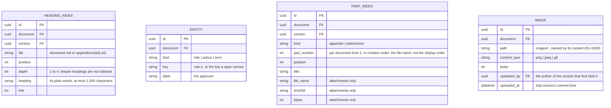
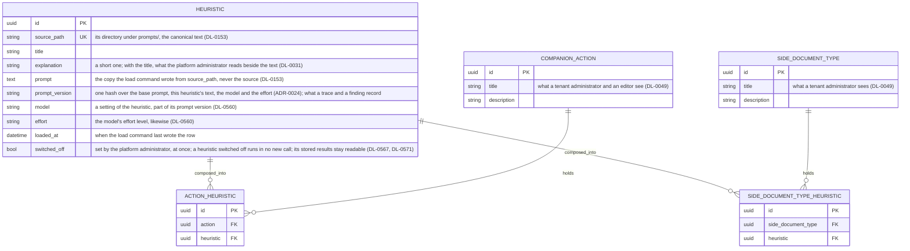

---
tags:
  - technical-design
aliases:
  - Syngraphē data model
status: active
date: 2026-09-21
---

# Data Model — releases 0.1 and 0.2

The editor and the exporter (DL-0043, DL-0081). The entities of release 0.2, the AI reader (DL-0558), are designed at the end, § Release 0.2 — the AI reader, with the stage 2 entities left for later listed after them: all of them hang off the stage 1 schema with no migration that rewrites a document, version or acceptance record (ASR-14).

## The rule that shapes everything below

**Git holds content. PostgreSQL holds everything else, and never a second copy of content.** The only content-derived rows are navigation and search indexes and the per-line authorship cache (`LINE_AUTHORSHIP`), all rebuildable from git at any time by replaying the repository. If a table would make git the second source of truth for a document's text, it is wrong.

**Every row says where it came from.** Each table carries `created_at`, `created_by` and an `actor_kind` of `user`, `system` or `agent`; mutable tables add `updated_at` and `updated_by` (DL-0082). `actor_kind` exists because this platform has three kinds of actor, and an agent-written row attributed to a person would be a lie in the audit trail. The columns are omitted from the diagrams below to keep them readable — read them as present on every table except these:

- the histories and `AUDIT_EVENT`, which carry their own timestamp and actor;
- the review and edition records — `ACCEPTANCE`, `CORRECTION_NOTICE`, `CORRECTION_LINE`, `RETURN`, `FREEZE`, `EDITION` — which carry their own reviewer, approver and time;
- `NOTIFICATION`, `PLATFORM_NOTIFICATION`, `MAIL_SENDER`, `EMAIL_OUTBOX`, `EXPORT_JOB` and `SAMPLE_EXPORT`, whose own columns say who asked or was told, and when;
- the editing tables `HOLD`, `DRAFT`, `DRAFT_FILE` and `OPEN_EDITOR`, whose own columns say who and when;
- three that are state without provenance: `SIGN_IN_ATTEMPT`, a counter no person writes; `SETUP_TOKEN`, written by the install command; `PASSWORD_RESET`, written for whoever asks at the sign-in page, before anyone is known, and swept a day after it is used or expires (DL-0413);
- `LINE_AUTHORSHIP`, a cache the worker derives from git, whose provenance is the commit it names.

**Placement follows tenancy** (DL-0029), and the rule is stated per purpose rather than per table so a new table has an answer before it is drawn:

- **Shared schema** — everything that identifies a person or an organisation, that is deliberately cross-cutting, or that is written before any tenant is known: `TENANT`, `USER`, `MEMBERSHIP`, `MEMBERSHIP_HISTORY`, `INVITATION`, `PASSWORD_RESET`, `LANGUAGE`, `AUDIT_EVENT`, `SIGN_IN_ATTEMPT`, `ACCOUNT_BLOCK_HISTORY`, `TENANT_STATE_HISTORY`, `USER_PREFERENCE`, `PLATFORM_HOST`, `TENANT_DOMAIN`, `SETUP_TOKEN`, `PLATFORM_NOTIFICATION`, the platform's `MAIL_SENDER` and its `EMAIL_OUTBOX` rows. A tenant's own `MAIL_SENDER` and its mail in `EMAIL_OUTBOX` live in the tenant's schema (DL-0203), so those two tables exist in both: the `mail` app is on both the shared and the tenant list, and a query reaches the tenant's rows when a tenant is set and the platform's only with the shared schema alone (ADR-0017). A person's `NOTIFICATION` lives in the tenant's schema, a platform administrator's `PLATFORM_NOTIFICATION` in the shared one (DL-0382). A reset's email is queued where DL-0383 places it — on an organisation's domain, that organisation's outbox; on the platform host, the outbox of the person's one active membership, else the shared one — and an organisation's outbox page leaves resets out (DL-0410).
- **Tenant schema** — everything scoped to one organisation's documents: every other table in this file, but the catalogue of release 0.2, which is the platform's and shared (§ Release 0.2 — the AI reader).
- **The framework's own tables are in the shared schema and are not drawn**: the sign-in sessions (`django_session`, twelve hours), the content types (`django_content_type`), the log of the framework's administration site (`django_admin_log`), and the framework's group and permission tables, which the platform does not use. Each schema keeps its own record of its migrations.

**`AUDIT_EVENT` is shared, with a nullable tenant**, and that is deliberate. A platform administrator creating a tenant performs an action belonging to no tenant, and an auditor asking *who created this organisation* must not first have to know which schema to look in. The isolation ASR-01 protects is document data; the audit log is cross-cutting by design and reachable only by administrators.

**`MEMBERSHIP_HISTORY`, `INVITATION`, `PASSWORD_RESET` and `LANGUAGE` are shared** because each is about the platform-level object beside it: a membership, an email address that is the platform identifier, a person, and a reference list every tenant draws from.

**The first-run setup token is one row in the shared schema** — its hash and expiry, deleted when used and ignored once expired (DL-0231, T-19). Using it is an `AUDIT_EVENT`. Once a platform administrator exists there is no row, and the first-run page answers as not found.

A query that needs a document and a user joins across the boundary deliberately — the boundary is visible in the code that crosses it.

## Platform, shared schema

```mermaid
erDiagram
    TENANT ||--o{ MEMBERSHIP : has
    USER ||--o{ MEMBERSHIP : holds
    USER {
        uuid id PK
        string email UK "platform identifier"
        string display_name "set by its holder on their account page; unique, compared in NFKC without case, invisible format characters or repeated spaces, among the active and blocked members of each organisation they belong to; cleared on erasure, identifier kept (DL-0523, DL-0537)"
        string password_hash
        bool is_platform_admin
        bool is_tombstoned "former user (DL-0108); the procedure is backlog B-017"
        bool self_blocked "blocks every membership; no control lifts it in release 0.1 (DL-0254)"
        bool is_superuser "operator of the framework's own interface (DL-0210); set from the command line, never by the application"
        datetime last_login_at
        datetime created_at "never exposed to a tenant admin"
    }
    USER ||--o{ INVITATION : invited_by
    INVITATION {
        uuid id PK
        uuid tenant FK
        string email
        string token_hash UK "single use"
        datetime expires_at
        datetime accepted_at
        uuid invited_by FK "domain field: who sent this invitation"
        uuid created_by FK "provenance: the same administrator, as every row records its writer"
    }
    USER ||--o{ PASSWORD_RESET : asked_for
    PASSWORD_RESET {
        uuid id PK
        uuid user FK
        string token_hash UK "single use"
        datetime expires_at "one hour (DL-0373)"
        datetime used_at
        datetime created_at
    }
    TENANT ||--o{ TENANT_DOMAIN : served_at
    TENANT_DOMAIN {
        uuid id PK
        uuid tenant FK
        string host UK "host name, optional port; set only by a platform administrator (ADR-0008)"
        bool is_default "one per tenant when it has any; builds the links in its emails"
    }
    PLATFORM_HOST {
        uuid id PK
        string host UK "the main set; at least one, 127.0.0.1 and localhost out of the box"
        bool is_default "exactly one; builds the links in platform emails"
    }
    SETUP_TOKEN {
        uuid id PK
        string token_hash UK "single use"
        datetime expires_at
    }
    EMAIL_OUTBOX {
        uuid id PK
        uuid tenant FK "null for platform mail"
        string sender "the address it left from"
        string recipient
        string subject
        text body "number, title, versions, people, event, state, link — never document text or the change summary (DL-0205); a credential link's token replaced once sent or failed (DL-0406)"
        string status "queued | sent | failed"
        int attempts "refusals so far; failed at the third, five minutes apart (DL-0203)"
        datetime next_attempt_at
        datetime sent_at
        string last_error "a reason code and the server's answer, never an exception's text"
        datetime created_at
        uuid notification_id "the notification it carries, of the same schema; no constraint, since neither notification table is in both"
        string kind "notification | invitation | reset; a reset is left out of an organisation's outbox page (DL-0410)"
    }
    USER ||--o{ PLATFORM_NOTIFICATION : told
    PLATFORM_NOTIFICATION {
        uuid id PK
        uuid user FK "a platform administrator"
        string event "backup_condition | email_failed | user_partially_blocked | tenant_without_admin (DL-0367, DL-0382)"
        json facts "ids and numbers only (DL-0370)"
        datetime created_at
        datetime read_at
        datetime emailed_at
    }
    TENANT {
        uuid id PK
        string name
        string schema_name UK "tenant_N, derived from the number, never typed (ADR-0017)"
        int number UK "platform-wide, from a sequence, in creation order, never reused; names the tenant's schema and directory (ADR-0008)"
        string state "migrating | active | blocked; migrating until its schema is fully migrated, resolvable by no request (ADR-0017); blocked closes it to all but platform administrators"
        bool require_distinct_approver "off by default (DL-0101, DL-0115)"
        int attachment_max_bytes "5 MB by default, in whole MB from 1 to the upload maximum (ADR-0005, DL-0458, DL-0469)"
        int hold_inactivity_minutes "30 by default, from 5 to 480 (ADR-0006, DL-0458)"
    }
    MEMBERSHIP {
        uuid id PK
        uuid tenant FK
        uuid user FK
        bool is_tenant_admin
        string state "active | blocked"
        datetime granted_at "what a tenant admin sees"
        uuid granted_by FK
    }
    MEMBERSHIP ||--o{ MEMBERSHIP_HISTORY : records
    MEMBERSHIP_HISTORY {
        uuid id PK
        uuid membership FK
        string field "is_tenant_admin | state"
        string before
        string after
        datetime at
        uuid by FK
        string actor_kind
    }
    USER ||--o{ ACCOUNT_BLOCK_HISTORY : records
    ACCOUNT_BLOCK_HISTORY {
        uuid id PK
        uuid user FK
        string action "self_blocked | block_lifted"
        datetime at
        uuid by FK
    }
    TENANT ||--o{ TENANT_STATE_HISTORY : records
    TENANT_STATE_HISTORY {
        uuid id PK
        uuid tenant FK
        string before "migrating | active | blocked"
        string after
        datetime at
        uuid by FK "null when migrate_schemas activates a migrating tenant (DL-0280)"
    }
    USER ||--o{ USER_PREFERENCE : keeps
    USER_PREFERENCE {
        uuid id PK
        uuid user FK
        string key "language (DL-0501) | show_author | outline_width | panel_width | outline_shut | panel_shut"
        string value
    }
    LANGUAGE {
        string code PK "uk | en"
        string label
        string never_final "abbreviations a stop after which never ends a sentence; one per line; seeded from the repository (ADR-0012)"
        string may_be_final "abbreviations a stop after which ends a sentence only before a capitalised word; one per line; seeded from the repository (ADR-0012)"
    }
    AUDIT_EVENT {
        uuid id PK
        uuid tenant FK "null for a platform-level action"
        uuid actor FK "null when the system acted"
        string actor_kind "user | system | agent"
        string action "tenant.created | document.archived | image.uploaded | entity.declared | ..."
        string object_type
        uuid object_id
        json before
        json after
        datetime at
    }
    SIGN_IN_ATTEMPT {
        string key PK "the client address; a hash of the address typed and the client; a device's; or a hash of a reset request's client"
        string key_kind "address | pair | device | reset"
        int consecutive_failures
        datetime next_allowed_at
        datetime last_failure_at
    }
```



**`SIGN_IN_ATTEMPT` is shared and deliberately keyless to a tenant.** Throttling happens before anyone is identified, so there is no tenant to scope it by; a row exists per client address and per pair of address typed and client — hashed, so the address typed is never stored — a browser that signed in before is counted on its device's row alone (DL-0293); the pair's or the device's row is reset on a successful sign-in, and rows older than a day are swept (DL-0289). It holds no reference to `USER`, because a row must be writable for an address that belongs to nobody — that is exactly the case the identical-response rule exists to hide (T-14). A reset request is counted on a `reset` row per client, a key apart from the client's sign-in row, never settled by a success (DL-0408).

**There is no self-registration** (DL-0107). A person exists because a tenant administrator invited them; `INVITATION` carries a hashed single-use token with a seven-day expiry, and sign-in, password reset and invitation acceptance all answer **identically whether or not an address is known** — they are the classic account-enumeration surfaces, and ASR-17 promises a tenant administrator learns nothing about a person's existence elsewhere. **An invitation creates the person and the membership at once** (DL-0374): a new address becomes a `USER` with no usable password, and both cases get their `MEMBERSHIP` with `granted_at` by the same clock; the link sets the password. Inviting again ends the organisation's earlier open invitation; spending any link — an invitation's or a reset's — ends every other open link to the person. A reset is a `PASSWORD_RESET` row, its token hashed, one hour long (DL-0373).

**`USER.is_tombstoned` is what erasure sets** (DL-0108): display name and email cleared, identifier kept, a *former user* label rendered in their place. Every reference from `created_by`, `ACCESS_CHANGE`, `ACCEPTANCE` and `EDITION` stays valid, so ASR-18 keeps its answers.

**Blocking has three levels** (ADR-0007). A tenant administrator sets `MEMBERSHIP.state` in organisations they administer; a person sets `USER.self_blocked`; a platform administrator sets `TENANT.state`. An active tenant keeps at least one active tenant administrator, memberships counted by their own state (DL-0409) — the last one may block themselves only as the tenant's last active user — and the last platform administrator can be neither blocked nor demoted. **An organisation's pages show a membership's own state and never a person's own block** (DL-0398): a self-blocked person's membership reads *active*, and its administrators may block and lift it, which changes the membership alone. A block of any level ends the holds and reservations it closes to the person (DL-0256), a membership's block ends the organisation's open invitations to the person, and an organisation's block all of its open invitations. Every block and every lifting of one is typed history — `MEMBERSHIP_HISTORY`, `ACCOUNT_BLOCK_HISTORY`, `TENANT_STATE_HISTORY` — so who could reach what on a past date stays answerable. A platform administrator is notified when a person ends up blocked in some tenants and active in others, and when a tenant is left without an active administrator.

**A tenant is `migrating` until its schema is complete** (ADR-0017). Its row is written before its schema is created and migrated; no request resolves it in that state; it becomes `active` only when its migrations have all run — in the act that creates it, or later, when `migrate_schemas` completes a schema a crash or a failed migration left half-made.

**`USER_PREFERENCE` holds the person's interface language as a `language` row** (DL-0498, DL-0501), `uk` or `en`, beside the page preferences and in the shared schema like them, since a platform administrator may hold no membership. A middleware applies it to each request after authentication; a person without the row gets the installation's default. An email is queued in its recipient's language, fixed at queuing; an invitation's in the installation's default, so the outbox tells an administrator nothing about the address's preference (ASR-17).

**`MEMBERSHIP.granted_at` is what a tenant administrator sees; `USER.created_at` is not** (ASR-17). Adding a user who already exists elsewhere on the platform must look identical to adding a new one — same screens, same wording, same timestamps. A tenant administrator's block sets `MEMBERSHIP.state`, never anything on `USER`; a person's own block is `USER.self_blocked` (below).

## Documents, tenant schema

```mermaid
erDiagram
    FOLDER ||--o{ FOLDER : contains
    FOLDER ||--o{ DOCUMENT : holds
    DOCUMENT_TYPE ||--o{ DOCUMENT : classifies
    DOCUMENT ||--o{ DOCUMENT_GROUP : linked_to
    ACCESS_GROUP ||--o{ DOCUMENT_GROUP : reaches
    ACCESS_GROUP ||--o{ GROUP_MEMBER : has
    ACCESS_GROUP ||--o{ GROUP_RIGHT : holds
    ACCESS_GROUP ||--o{ ACCESS_CHANGE : records
    DOCUMENT ||--o{ VERSION : has
    DOCUMENT ||--o{ HOLD : held_by
    DOCUMENT ||--o{ HEADING_INDEX : indexed_by
    DOCUMENT ||--o{ PART_INDEX : lists
    DOCUMENT ||--o{ IMAGE : embeds
    DOCUMENT ||--o{ ENTITY : declares
    DOCUMENT {
        uuid id PK
        int number "per tenant, #7; assigned in creation order, never edited or reused (ADR-0008)"
        string title "cache of document.md frontmatter"
        string language FK "cache of document.md frontmatter"
        uuid document_type FK
        uuid folder FK "required; presentation only; moved by a tenant administrator"
        uuid created_by
        bool author_only "true until the first group is linked (ADR-0007)"
        uuid copied_from FK "source document of a copy; null otherwise"
        datetime created_at
        string state "creating | active | archived"
    }
    DOCUMENT_TYPE {
        uuid id PK
        string code UK "per tenant; seeded with document, which is renamed or retired, never deleted (DL-0235, DL-10-002)"
        datetime retired_at "set when retired; a type still assigned is retired, never deleted; the last type not retired is neither (DL-10-001)"
        string label "one printable line of 1 to 100 characters, unique among the tenant's types in any case, retired ones included (DL-10-001)"
    }
    FOLDER {
        uuid id PK
        int number "per tenant, root is 1, the others from a sequence starting at 2; in URLs (ADR-0008)"
        uuid parent FK "null at the root alone"
        string name "one printable line of 1 to 200 characters, unique among its siblings in any case (DL-0453); the root's is empty, drawn as the tenant's name, never edited"
    }
    MAIL_SENDER {
        uuid id PK
        string host
        int port "1 to 65535"
        string address "the sending address; one per schema at most (DL-0202)"
        bool one UK "always true: a unique column every row shares, so a schema holds one sender at most"
        datetime updated_at
        string display_name "the sender's name in the From line, optional"
        string username "empty: no sign-in"
        bytes password_encrypted "authenticated encryption; key from the environment (DL-0384)"
        string security "starttls | tls | none (DL-0371); sign-in without encryption only to the same machine (DL-0388)"
        datetime last_test_requested_at "one test at a time (DL-0392)"
        datetime last_test_at
        string last_test_result "each step's outcome"
    }
    DOCUMENT_TEMPLATE {
        uuid id PK
        text outline "Markdown: section headings, optional starting text; at most 20,000 bytes"
        bool title_page "whether new documents get a title page"
        text title_page_layout "which details the title page shows, in which order, aligned how; empty for the default form (DL-0462); among them the document's own title-page text, kept in its frontmatter (DL-0476)"
    }
    ACCESS_GROUP {
        uuid id PK
        string name UK "per tenant; at most 100 characters"
    }
    GROUP_RIGHT {
        uuid id PK
        uuid group FK
        string right "view_canonical | view_accepted | view_pending | edit | create_and_edit | view_previous_canonical | view_all_history | accept | freeze | make_canonical | reserve_for_editing | create_appendix | delete_appendix | upload_attachment | replace_attachment | delete_attachment"
    }
    GROUP_MEMBER {
        uuid id PK
        uuid group FK
        uuid membership FK
    }
    DOCUMENT_GROUP {
        uuid id PK
        uuid document FK
        uuid group FK
    }
    ACCESS_CHANGE {
        uuid id PK
        string kind "member | right | link"
        uuid group FK
        uuid document FK "for a link"
        uuid membership FK "for a member"
        string right "for a right"
        string action "added | removed"
        datetime at
        uuid by
        string actor_kind
    }
```



**`DOCUMENT.number` is the identity people use and never changes** (ASR-15, ADR-0008) — unique within the tenant, shown as `#7`, and the document's URL. `FOLDER` is presentation; moving a document rewrites one foreign key and nothing in git. **The repository on disk is `tenant-N/document-M/`** (ADR-0008) — `TENANT.number` and `DOCUMENT.number`, never a title; a directory named by title puts document titles, a confidential guidance document's included, into filesystem listings, backup manifests and operator shells that the access table does not govern.

**`creating` is the state that exists because document creation is the one two-store write** (DL-0111): row written `creating`, repository initialised and given its first commit — `document.md` with frontmatter and a body taken from the organisation's `DOCUMENT_TEMPLATE` (DL-0169) — row becomes `active`; that it reaches only its author is `author_only`, not a state (DL-0260). Title, language, the title-page switch, the title page's own text (DL-0476) and the lists of appendices and attachments live in that frontmatter (ADR-0005), which is what lets a repository restored without its row recover them. The reconciler finishes a creation that stopped — except a copy, whose source the audit trail names before its repository is touched: a stopped copy is left unfinished and reported, and the operator removes it (DL-0455) — and recreates the row of a repository without one, with no access, never deleting a repository.

**Groups are the whole permission model** (ADR-0007, ASR-07, ASR-08). A document's `DOCUMENT_GROUP` rows cannot change while a `HOLD` on it is open. A group holds rights (`GROUP_RIGHT`), has members (`GROUP_MEMBER`, through their tenant membership) and is linked to documents (`DOCUMENT_GROUP`); a person's rights on a document are the union of the rights of their groups linked to it. `create_and_edit` is the one right not tied to a link: it lets a member create and copy documents. The part rights apply only where the group can edit. *Accept*, *freeze* and *reserve_for_editing* include *edit* and the views below it, *make_canonical* includes *view_accepted* — an included right is implied, not stored (ADR-0016, DL-0234). Every right covers a whole document; there is no scope column (DL-0091). Comment is not among the rights; the annotation surface is stage 2 (DL-0083). The group table is `ACCESS_GROUP` so it does not collide with the framework's own.

**`MAIL_SENDER` holds a tenant's own sending address, at most one row** (DL-0202); with none, the platform's sender in the shared schema is used. The password is stored only encrypted and is never read back into the interface.

**`DOCUMENT_TEMPLATE` has one row per tenant in stage 1** (DL-0169): the outline a new document starts from — at most 20,000 bytes (DL-0481), put in normal form for the new document's language at its first commit — whether it gets a title page, and the title page's layout — which of the document's details it shows, in which order, left or centred, the approval line always among them at a position of its own — a structured choice stored as data, never a template the page renders through (ADR-0005, DL-0462, DL-0475). The tenant administrator edits it in place; it is configuration, not a document, and has no history beyond `AUDIT_EVENT`.

**A new or copied document is author-only** (ADR-0007): `author_only` is set, no group is linked, and only its creator reaches it, with edit. The tenant administrator is notified and links groups; the first link clears `author_only`, after which the author reaches the document through their groups. A copy records `copied_from`, and its `document.copied` `AUDIT_EVENT` — written before its repository exists — holds the source's number, the version's number and commit and the appendices taken; the copy's *Info* page shows administrators the source, the version and the commit, with when and by whom it was copied (DL-0455). A document with no `accept` holder renders as *no reviewer assigned*, and acceptance is refused with that reason.

**Two audit mechanisms, split by a single question: must the answer be reconstructible at a past date?** (DL-0082)

- **Yes → typed, append-only history.** `MEMBERSHIP_HISTORY` and `ACCESS_CHANGE` — every membership, right and link added or removed — exist so that *"who could read this document on the day that edition was approved"* is a query, not an inference from a replayed event stream. A grant, membership or link is removed from its current table and its removal written to the history in the same transaction; the history tables — with `ACCOUNT_BLOCK_HISTORY` and `TENANT_STATE_HISTORY` — refuse an update or a delete by database trigger, as `AUDIT_EVENT` does (DL-0459). The access history reads one fact beside them from `AUDIT_EVENT`: whether the document was archived at the moment asked (DL-0433, DL-0468).
- **No → `AUDIT_EVENT`.** Everything else a person did and should be answerable for: assigning a document type, moving a document to a folder, archiving and restoring, changing the template or the stylesheet, uploading an image. One table, actor and object typed loosely, because nobody reconstructs state from it — they read it.

**Archiving preserves rights rather than removing them** (DL-0084). `DOCUMENT.state` goes to `archived`; its `DOCUMENT_GROUP` links stay, take no effect while it is archived, remain editable by the tenant administrator, and **apply as they then stand** on restore. An archived document enters no analysis scope and is exported only by administrators. Rebuilding a permission set by hand is exactly where a restored document quietly becomes readable by the wrong people. Archiving is visible to tenant and platform administrators only, and an archived document's links stop resolving everywhere — including where its name sits in another document's prose. Archiving ends the document's open hold as a forced release does — `release_kind` `forced`, `released_by` the archiving administrator, `release_reason` the platform's own `archived`, the draft kept where it holds edits — and tells the holder (`document_archived`, DL-0471); a finish that stopped after its commit is completed instead (DL-0414).

## Versions, holds and drafts

```mermaid
erDiagram
    DOCUMENT ||--o{ VERSION : has
    VERSION ||--o| ACCEPTANCE : accepted_by
    VERSION ||--o| EDITION : made_canonical_as
    DOCUMENT ||--o{ FREEZE : frozen_by
    DOCUMENT ||--o{ HOLD : held_by
    HOLD ||--o| DRAFT : drafted_in
    VERSION ||--o{ LINE_AUTHORSHIP : attributed_in
    VERSION {
        uuid id PK
        uuid document FK
        string commit_sha UK
        uuid author FK "git author name is this id; email is {id}@users.noreply.syngraphe.local"
        text summary "the commit's message less its trailers: the first line its subject, at most 500 characters, the rest its body, the whole at most 5,000; starts from a mechanical draft naming the sections touched, the author edits it (DL-0261, DL-0532, DL-0535); the companion's draft of it is not in release 0.2 (DL-0555, B-072)"
        string kind "created | edit | reviewer_edit | acceptance | return | approval — created: the first commit of a new or copied document (DL-0268); reviewer_edit: a content version committed by a holder of accept (ADR-0014); the last three are passport commits (DL-0260)"
        datetime committed_at
    }
    ACCEPTANCE {
        uuid id PK
        uuid version FK "the passport commit"
        uuid accepted_from FK "the content version the previous acceptance accepted; for the first acceptance, the version the document was created with"
        string number "N.M, derived (DL-0183)"
        uuid reviewer FK
        datetime at
        datetime notices_computed_at "set with its correction notices; null until computed, so an acceptance with no notices is told from one not yet computed"
    }
    ACCEPTANCE ||--o{ CORRECTION_NOTICE : generates
    CORRECTION_NOTICE {
        uuid id PK
        uuid acceptance FK
        uuid author FK "whose lines were changed; one notice per author per acceptance (ADR-0014)"
        datetime at
    }
    CORRECTION_NOTICE ||--|{ CORRECTION_LINE : lists
    CORRECTION_LINE {
        uuid id PK
        uuid notice FK
        uuid changing_version FK "a reviewer_edit version of the run, or the acceptor's own version; its author is who changed it (ADR-0014)"
        string entry "line | restored | part_operation — a line the author wrote, a line the author removed that was restored, an appendix or attachment operation reverted"
        string part "the appendix or attachment, for a part operation: its path beside document.md; empty for a line"
        uuid author_version FK "the version that wrote the line, or, for restored, the version that removed it; render the original from here, or from its parent for restored"
        string file
        string range_before "line range in the author's version, or in its parent for restored"
        string range_after "line range in the accepted version; empty for a removal"
    }
    VERSION ||--o| RETURN : returned_by
    RETURN {
        uuid id PK
        uuid version FK "the passport commit"
        uuid returned_from FK "the content version the latest acceptance before it accepted; where there is none, the version the document was created with"
        uuid reviewer FK
        text reason "required: one line, at most 500 characters, no control, reordering or invisible format character but the two joiners (DL-0378, DL-0483)"
        datetime at
    }
    FREEZE {
        uuid id PK
        uuid document FK
        text reason "optional: what the document waits for — one line, at most 500 characters (DL-0353)"
        uuid frozen_by FK
        datetime frozen_at
        string ended_by_kind "made_canonical | unfrozen; empty while active"
        uuid ended_by FK "empty when an operator ended it"
        datetime ended_at
    }
    EDITION {
        uuid id PK
        uuid version FK "the accepted version made canonical"
        uuid approval_version FK "the passport commit that records the approval, tagged (DL-0260)"
        uuid freeze FK "the freeze it ended"
        string number "N.0 (DL-0183)"
        uuid approved_by FK
        datetime approved_at
    }
    HOLD {
        uuid id PK
        uuid document FK
        uuid user FK
        datetime acquired_at
        datetime last_activity_at "released after the tenant's inactivity timeout, unless reserved (ADR-0006)"
        datetime reserved_at "set while reserved for editing; exempt from the inactivity release (ADR-0009)"
        datetime released_at
        uuid released_by FK "the administrator who forced it, or who archived the document; the blocking administrator when blocked; null for a finish, a discard, an inactivity release, a self-block, or a release forced from the operator's command"
        string release_kind "finished | accepting | discarded | released | inactivity | forced | blocked — released when the holder lets go of a hold with no edits (DL-0510); blocked when the holder's membership, account or tenant is blocked (DL-0256); accepting while an *accept as* has its version and not yet its acceptance (DL-0397); finished also when another's release completes a finish that stopped after its commit, the actor in the audit (DL-0414)"
        string release_reason "required when an administrator ends a reservation (DL-0225); the platform's archived when archiving ended the hold, a word an administrator's reason may not be"
    }
    LINE_AUTHORSHIP {
        uuid id PK
        uuid version FK "kept for the head and the latest accepted version; older versions computed on demand (DL-0266)"
        string file
        int line
        uuid introduced_by FK "the version that introduced the line"
        bool ambiguous_move "a verbatim line matched more than once; recorded, not guessed (ADR-0011)"
        datetime expires_at "null for the kept versions; a day ahead on rows computed on demand, swept hourly"
    }
    DRAFT {
        uuid id PK
        uuid hold FK
        string base_commit "the head's commit when the hold was taken (DL-0318)"
        json content "per-file working text: body, each listed appendix under appendices/<n>.md, frontmatter with its lists, entities.yaml (the head's when the hold was taken, and every declaration made since); after a reviewer's revert, revert: each part put back, with the head it was taken from and what was staged; after an undo, undo: the versions undone and the places left for the holder's hand, each with its wording before, what the undone versions wrote and what stands now — an appendix's place with the appendix's title — and an entry naming a title, a part or the entities the undone versions changed — those stand — never in the text (DL-0380)"
        datetime updated_at
        json opening "what the edit tab opens with, read from this draft by the worker after a capture: whether it holds edits and the declarations Mark offers, under a key over every input they were read from; read again when the key no longer matches, never trusted otherwise (DL-23-001)"
    }
    DRAFT ||--o{ DRAFT_FILE : stages
    DRAFT_FILE {
        uuid id PK
        uuid draft FK
        string kind "image | attachment"
        string path "images/<sha256>.<ext> (DL-0439) or attachments/{id}"
        string operation "add | replace | remove"
        bytes content "null for remove"
        string file_name
        string sha256
        datetime at
    }
    DRAFT ||--o{ OPEN_EDITOR : edited_through
    OPEN_EDITOR {
        uuid id PK
        uuid draft FK
        string file "document.md or appendices/{id}.md"
        string range "whole: the editor spans its file, and there is no section editor (DL-0517)"
        string base_hash "hash of the range as this editor last saw it"
        datetime last_seen_at "heartbeat"
        datetime closed_at
    }
```



**`VERSION.commit_sha` is the join to git**, and the row is a cache of what the commit already says — rebuildable, never authoritative. **`VERSION.author` is the only link between a commit and a person** (DL-0088): git holds the identifier, this table holds the mapping, and nothing personal is in the repository at all. Removing a person's **name and address** from the database therefore anonymises the record without rewriting history — pseudonymisation by construction. It does not remove the person from the record: `created_by`, `ACCESS_CHANGE`, `ACCEPTANCE` and `EDITION` all reference the identifier, and emptying those would destroy the audit answers ASR-18 promises. The erasure shape is a **tombstone** — identifier kept, name and address gone, a *former user* label in their place — settled at DL-0108.

**Each commit carries its kind** in a last paragraph of trailers, `Kind: created | edit | reviewer_edit | acceptance | return | approval`, the values of `VERSION.kind`, so a version row is derivable from its commit alone. A commit's summary — its first line the subject, the lines after a blank line its body (DL-0532) — is written by the platform or by the author, never a title or a name; `VERSION.summary` holds it whole, and the lists read its first line. The reconciler derives rows for the content kinds from the trailer; a passport's kinds are derived from the passport.

**The passport, `passport.md`, is an append-only file of decisions.** Its frontmatter holds `document` and `tenant`, the numbers the repository belongs to, which the reconciler checks before trusting a repository; then one `##` section per passport commit — `## acceptance 2.3`, `## return`, `## approval 3.0` — each with `at` (UTC, to the second), `by` (a user identifier), `version` (the content commit it decides on), and `reason` for a return, `edition` for an approval, one `name: value` line each. Identifiers only, never a name (DL-0088). A section is read back before it is committed, and the rows of an acceptance are derived only from a section exactly as the platform writes one: the passport alone changed, one section appended by its commit's author, numbered next, deciding on the last content version before it.

**`CORRECTION_NOTICE` is generated, never authored** (DL-0102, ADR-0001, ADR-0014), and it **holds references, not text** (DL-0113). It is written at acceptance, one row per author whose changes in the run a `reviewer_edit` version — or the acceptor's own version — replaced or reversed: a line written, a line removed and restored, an appendix or attachment operation reverted; a `CORRECTION_LINE` per change names the changing version (ADR-0014). `created` versions and moved lines generate nothing; nothing is written when a version is committed. Lines of `document.md` and of each appendix the run touched are computed, each with its `file`, and a part operation another author's version set and a covered version changed is a `part_operation` entry naming the part. For a restored line the entry discloses the remover's act: the notice goes to the remover (`CORRECTION_NOTICE.author`), `author_version` is the version that removed the line, and `range_before` the line's place in that version's parent. Both wordings are rendered from git when the notice is opened, under the reader's **current** rights — a stored copy would survive a revoked right and an archived document, and would escape the access table entirely, since a notice is read through the notification surface. In stage 2 it becomes the durable rejection record and gains an escalation path; the table is its first form, not a placeholder.

**`RETURN` is the other reviewer decision, and it is a commit** (DL-0114). Its row is derived from the return's passport section — by the act, by the next writer that settles the head, or by the reconciler, which also reports a row that disagrees with its section — as an acceptance's is; the reviewer's reason is the act's, required and bounded (DL-0378), read in the application and never sent by email (DL-0369). The document reads *returned* while the latest of the run's commits after the last acceptance is a return. Returning a run without accepting it writes the passport exactly as an acceptance does, so the review history needs no second system to be believed and an export shows it. The derived row gives the document list what it needs to say *returned to its authors* rather than *awaiting review*. The next send for review presents the whole run since the last acceptance, returned versions included.

**`TENANT.require_distinct_approver`** enforces the one optional segregation check: when set, `EDITION.approved_by` may not be the reviewer of **any** `ACCEPTANCE` between the previous canonical edition and this one (DL-0101, DL-0115). Not merely the last — accept a substantive run yourself, have a colleague accept a following run that changes a comma, and *last* stops meaning anything.

**Version numbers are derived, never typed** (DL-0183). Each acceptance is numbered `N.M`: N is the count of canonical editions before it, M counts acceptances since the last one and restarts at 1 — so 0.1, 0.2 before the first canonical edition. Making a document canonical, frozen or not (DL-0515), turns its latest accepted version into `N+1.0`; unfreezing changes no number. Numbers are written into the passport with the acceptance and the approval, so the repository carries them; these columns are caches.

**A freeze is a state of the document, an edition is a canonical version** (DL-0189). A `FREEZE` row with no `ended_at` means the document is frozen: only holders of *accept* may open an editor (ADR-0016). It ends by *make canonical*, which writes a passport commit — `VERSION.kind` `approval`, tagged — and an `EDITION` for the latest accepted version (DL-0260), or by *unfreeze*. An edition approved while no freeze is open records a `FREEZE` row begun and ended at the approval, written with it, so `EDITION.freeze` always resolves and the schema is unchanged; History draws no freeze for it (DL-0515). The three stances fall out of these tables without a state column anywhere: canonical is the latest `EDITION`; accepted is the latest `ACCEPTANCE`; pending is every content version — `edit`, `reviewer_edit` — after it (DL-0267).

**A reservation is a mark on `HOLD`, not a table** (ADR-0009, DL-0221). `reserved_at` set means the hold is exempt from the inactivity release; cancelling clears it and sets `last_activity_at` to that moment, so the inactivity clock starts afresh. It is set only by a holder whose group linked to the document holds `reserve_for_editing`, which includes `edit` (ADR-0016), and never while a `FREEZE` is open. As for any open hold, freezing, `DOCUMENT_GROUP` changes and correction are refused; while it is set, acceptance and return are refused as well, the holder's own *Accept the run* included — the holder's *accept as N.M* ends the reservation in the same act (DL-0224). Starting, cancelling and ending a reservation each write an `AUDIT_EVENT`, so the record keeps every reservation after `reserved_at` is cleared (DL-0221). An administrator ending it also records `released_by`, `release_kind` `forced` and `release_reason`, puts the draft's state in that event, and notifies the holder (`reservation_ended_by_admin`); starting one notifies the tenant administrator (`reservation_started`).

**A block ends the hold** (DL-0256). Blocking a membership, an account or a tenant releases every hold and reservation of the person it closes documents to, with `release_kind` `blocked`, an `AUDIT_EVENT` naming the block and the draft's state, and the draft kept as after a forced release — unless a finish of the hold had stopped after its commit, which the release completes instead (DL-0414).

**`DRAFT` hangs off `HOLD`, not off `DOCUMENT`.** A hold someone else ended — forced, ended by an administrator, released for inactivity, blocked — keeps its draft for its holder (ADR-0003), and the foreign key is what makes that automatic rather than remembered; a finish and a discard, the holder's own ends, delete it. The holder's latest such hold with a draft is their *kept draft*: *Edit* offers it back before any new hold is taken. `base_commit` is the head the draft started from: the kept draft is taken back — its row moved to the new hold — only while `base_commit` is still the head, read under the lock; otherwise it is shown read-only and may be discarded (DL-0318, DL-0381). A finish that committed and then stopped is recognised by a content commit of the holder's after it, `edit` or `reviewer_edit`, with nothing but acceptances or returns above it (DL-0318, DL-0335); a release that would keep such a draft completes the finish instead, and nothing is kept (DL-0414).

**`DRAFT_FILE` holds uploads until they are committed** (ADR-0005). An image or attachment added, replaced or removed during a hold waits here, under the same point-in-time recovery as the draft's text, and is written to the repository by the commit that finishes the session. It is the first copy of that content, not a second one.

**`OPEN_EDITOR` is what makes two editors over one draft safe** (ADR-0006) — the same draft open in two browser tabs. A capture is accepted only while the file still hashes to `base_hash`; an editor with no heartbeat past the timeout is closed; finishing and discarding are refused while any row is open. Every editor spans its whole file: there is no section editor (DL-0517).

## Content index, entities, images



**`HEADING_INDEX` is a cache and says so** — rebuilt by parsing `document.md` and each appendix at a version, and read by nothing in release 0.1; the outline and the numbers are read from the rendered text itself. Rows are kept for the head and its parent, the latest accepted version and every edition, and the others' dropped when a version is derived.

**Appendices and attachments are numbered per document from 1** in creation order (ADR-0008); the number names the file, appears in the part's URL, and never changes when parts are reordered.

**`PART_INDEX` is the same kind of cache** over the frontmatter's lists of appendices and attachments (ADR-0005), so a document page can list its parts without reading git. Git is the authority; the rows are rebuilt per version. An attachment's file is stored at `attachments/<n>`, `n` its number from 1, without an extension; its original name, hash and size live in the frontmatter entry (DL-0342).

**There is no paragraph table, and that is deliberate.** Clause numbers are rendered labels derived from depth (DL-0065), and anything that must point at a passage — a finding, and later a comment — anchors with W3C text-quote selectors (DL-0027). Storing paragraph identifiers would put structure in two places and make every edit a reconciliation.

**Comments are not here.** Threads, anchors and resolution are a surface rather than a field, and the whole of it is stage 2 (DL-0083).

**`ENTITY` mirrors `entities.yaml` for lookup.** Occurrences are the attributed spans in the text and are not stored: the role directory is produced by parsing the sections at a version (DL-0073), which is why it ships in stage 1 without an agent. The rows are replaced from the head's `entities.yaml` whenever a version is derived; a role, action or term marked in the text without a declaration is declared at the commit, labelled with its words (DL-0440). A declaration made in the editor waits in the draft's `entities.yaml` until then, audited as `entity.declared`.

**`IMAGE` records each image a version first held**, rebuilt from git when a version is derived and never pruned: an image is read from the repository at the version its reader may see. An upload waits in `DRAFT_FILE` until the commit, audited as `image.uploaded` (DL-0439).

## Notifications and export

```mermaid
erDiagram
    NOTIFICATION {
        uuid id PK
        uuid user FK
        uuid document FK "null where the event concerns no document (DL-0367), and for document_archived, which names the number alone (DL-0471)"
        string category "document | administrative (DL-0204)"
        string event "version_committed | accepted | returned | correction_notice | frozen | unfrozen | made_canonical | hold_expiring | reservation_started | reservation_ended_by_admin | access_granted | document_created | document_copied | document_archived | email_failed"
        uuid version FK
        uuid correction_notice FK "set for event correction_notice; one notification per notice"
        json facts "ids and numbers only — never an address, a title or a line of text (DL-0370)"
        datetime created_at
        datetime read_at
        datetime emailed_at
    }
    EXPORT_JOB {
        uuid id PK
        uuid document FK
        uuid version FK
        bool include_document
        string appendices "none | embedded | separate"
        bool include_attachments
        string format "pdf | docx | markdown"
        string view "canonical | accepted | pending_edits | my_edits"
        string changes "marked | clean"
        uuid baseline_version FK "set exactly when marked"
        bool at_version "asked from a version's page: re-checked against the reader's ceiling (DL-0423)"
        uuid requested_by FK
        string state "queued | done | failed"
        string artifact_ref "job id / file name, under the exports root"
        string failure_reason
        datetime created_at
    }
    STYLESHEET {
        uuid id PK
        text text "CSS within the allowlist, at most 100,000 bytes; empty for the platform's default look (DL-0464)"
    }
    SAMPLE_EXPORT {
        uuid id PK
        string format "pdf | docx"
        text stylesheet "the text in the styles page's box when asked, never applied (DL-0466)"
        string language "the interface's, choosing the invented sample's text"
        uuid requested_by FK
        string state "queued | done | failed"
        string artifact_ref "under the exports root; set exactly when done"
        string failure_reason
        datetime created_at
    }
```



**A `NOTIFICATION` lives in the tenant's schema**, beside the document it concerns, an organisation's administrative ones with them; a platform administrator's own — a backup condition, a failed email — is a `PLATFORM_NOTIFICATION` in the shared schema, since a platform administrator may belong to no organisation (DL-0382). A notification is opened at its own address, never a document's, and only by its person; one about a document its person can no longer open is neither shown nor counted (DL-0386).

**`EMAIL_OUTBOX` is written before any attempt to send** (DL-0203), in the notification's own transaction: three attempts five minutes apart, then *failed* and an in-application notification to the tenant's and the platform's administrators. It is also the log of every notification email sent; *Send a test email* goes to the server directly and keeps only its latest steps on the sender row (DL-0392). With no sender configured, nothing is queued. The recipient's right is read again at the send, and an email about a document they can no longer open fails without telling anyone (DL-0387); an email whose sender's password cannot be read for want of the key waits, its attempts untouched (DL-0389).

**`NOTIFICATION.emailed_at` separates the two surfaces**: the in-application record exists whether or not mail was sent. The platform's sender is one row in the shared schema, a tenant's own sender one row in its schema; each password is encrypted at rest and write-only in the interface (DL-0072, DL-0202).

**`EXPORT_JOB.version` is required**, not defaulted to the latest. An export is of a stated version — usually the canonical edition — and a job that silently followed the head would produce documents nobody can reproduce. What, format, view and changes are the choices the export screen composes (DL-0172, DL-0193); *changes* marks the text against `baseline_version`, the version before it in the chain (DL-0241) — for a job asked at a version, the chain of the stance that version reached, set only where the reader's ceiling reaches it (DL-0426) — and a Markdown export is always clean; a *my edits* export reads the requester's own draft as well as the version. A job asked from a version's historical page records it in `at_version`, and is re-checked when it runs against the versions the reader may open — the version and its baseline — rather than the view's rights (DL-0423). The row is written before the job is queued; `render` holds it while it runs, so a job queued twice runs once; its file is swept after a day and the row stays, with `failure_reason` naming what the platform refused or that the file could not be made.

**`STYLESHEET` has one row per tenant**, seeded empty (DL-0464, DL-0465): every document of the organisation is read and exported with it, and with the platform's default look while it is empty — no document chooses another. Its text is checked against the allowlist when it is applied and again by every reader of it, so a row written before a rule tightened reaches no page and no file; every change is audited with the whole text before and after, which is its only history (DL-0477). The Word files' reference document is derived from it, never stored.

**A `SAMPLE_EXPORT` is the styles page's trial of a stylesheet** (DL-0466): a built-in invented text, in the requester's interface language (DL-0498), rendered with the text in the box. One may be queued or running per tenant at a time; the row is written and audited before it is queued, failed when the queue refuses it or it has waited half an hour unheld, and swept with the exports after a day.

## What the database itself refuses

Beside the rules drawn above, these hold as constraints, so no code path can break them:

- **One of each:** a membership per tenant and user; a preference value per user and key; a row per pair in `GROUP_RIGHT`, `GROUP_MEMBER` and `DOCUMENT_GROUP`; an entity per document, kind and key; an image per document and path; an authorship row per version, file and line; a correction notice per acceptance and author; an edition per version, per approval commit and per freeze.
- **One open at a time:** one open hold per document, released with exactly one kind, `released_by` set only for `forced` and `blocked`; one open freeze per document, ended with exactly one kind and never before it began.
- **Shapes:** an acceptance's number is `N.M` and an edition's `N.0`, N from 1; a correction line's range is `12`, `12-14` or empty; a `correction_notice` notification names its notice, and a `document` notification its document, `document_archived` excepted (DL-0471); a `done` export or sample has its file.
- **Who acted:** on every table with provenance, on `ACCESS_CHANGE` and on `AUDIT_EVENT`, a `system` row names no person, a `user` row names one, and an `agent` row may name either.
- **Nothing a record references is deleted.** Every reference refuses the deletion of what it points at, except the caches' and a draft's own rows — `HEADING_INDEX`, `PART_INDEX`, `ENTITY`, `IMAGE`, `LINE_AUTHORSHIP`, `DRAFT_FILE`, `OPEN_EDITOR`, `CORRECTION_LINE` — which go with their owner.

The audit log, the access history, the outbox and the throttling sweep each read through an index on the columns they filter by.

## Release 0.2 — the AI reader

Designed, not built: release 0.1 has none of it. Release 0.2 (DL-0558) carries the findings and the AI workbench they run on (DL-0555, DL-0557). Every table below is new and hangs off `DOCUMENT`, `VERSION` and `ACCEPTANCE` by reference; none of those gains a column, and no migration rewrites a document, version or acceptance record (ASR-14). What release 0.2 adds to a table drawn above is one column on `TENANT` and two values of a notification's `event`, both named below.

### The catalogue, shared schema



**The catalogue is the platform's, so it is shared** (DL-0049): three levels, administered by the platform administrator alone. A `HEURISTIC` is one focused piece of prompt text; a `COMPANION_ACTION` is a set of heuristics producing a user-facing analysis; a `SIDE_DOCUMENT_TYPE` is a set of heuristics producing and maintaining a generated view — in release 0.2, the standing lists (DL-0555), three types, one per list: *contradictions* (A01, A04, A05), *ambiguities* (A02) and *blind spots* (A03, A06) (DL-0567, DL-0571 (3)). The two join tables say which heuristics each holds. D01, B01, B02, B03 and B05 are in neither: they belong to no assignable unit, and the reviewer agent runs them for every document assigned any analysis (DL-0571 (2)). A tenant administrator reads the titles and descriptions of actions and side-document types and never a `HEURISTIC` row.

**A `HEURISTIC` row is a copy, and says where it came from** (DL-0153). `prompts/` is canonical; the load command writes each row from its `source_path`, idempotently, and reports every row that differs from its source. The command refuses a prompt version with no dated result at its target in `evals/` under the same hash (ADR-0024), and likewise one without a passing adversarial result under its hash (DL-0571 (12)), so a `prompt_version` in this table always names results that exist and pass. The source version a row came from and its `prompt_version` are one value. **No row's `prompt` is edited in place** (DL-0567): a heuristic changes only through `prompts/`, its evals and the load, and the platform administrator's one act on a row is to switch it off, at once. A heuristic switched off runs in no new call; its stored results stay readable, and an analysis already running completes (DL-0571 (15)).

**The model and its effort are the heuristic's own** (DL-0560): hashed into `prompt_version` with the base prompt and the heuristic's text, so changing either is a prompt change with its own eval results. A call runs one heuristic (ADR-0022), which is why the version is the heuristic's and not an action's.

### Assignment, scope, runs and findings, tenant schema

```mermaid
erDiagram
    DOCUMENT ||--o{ DOCUMENT_ANALYSIS : assigned
    DOCUMENT ||--o{ REVIEW_SCOPE : reviewed_within
    REVIEW_SCOPE ||--o{ REVIEW_SCOPE_DOCUMENT : holds
    DOCUMENT ||--o{ ANALYSIS_RUN : analysed_by
    ANALYSIS_RUN ||--o{ TRACE : made
    TRACE ||--|{ TRACE_DOCUMENT : read
    ANALYSIS_RUN ||--o{ FINDING : reports
    TRACE ||--o{ FINDING : produced
    FINDING ||--o{ FINDING_QUOTE : rests_on
    ANALYSIS_RUN ||--o| ANALYSIS_MARK : marked_not_right
    ACCEPTANCE ||--o| STANDING_SET : has
    ANALYSIS_RUN ||--o| STANDING_SET : computed
    DOCUMENT_ANALYSIS {
        uuid id PK
        uuid document FK
        uuid companion_action FK "shared schema; exactly one of the two is set"
        uuid side_document_type FK "shared schema"
    }
    DEFAULT_ANALYSIS {
        uuid id PK
        uuid companion_action FK "shared schema; exactly one of the two is set"
        uuid side_document_type FK "shared schema"
    }
    REVIEW_SCOPE {
        uuid id PK
        uuid document FK "the document under review"
        uuid reviewer FK "who chose it; scopes are indexed per person, results are not (DL-0078)"
    }
    REVIEW_SCOPE_DOCUMENT {
        uuid id PK
        uuid scope FK
        uuid document FK "a neighbour the reviewer picked, among the documents they may read that are themselves assigned an analysis (DL-0077, DL-0565, DL-0571); read at its accepted state (DL-0569)"
        int position "the set is ordered (DL-0078)"
    }
    ANALYSIS_RUN {
        uuid id PK
        uuid document FK
        string kind "companion | review | standing; a guidance kind is later (DL-0568, B-079)"
        uuid companion_action FK "shared schema; for a companion run, the action called"
        string content_state "a hash of the document's tree without passport.md and analysis/ (DL-0056, DL-0571); for a companion run, of the draft"
        uuid version FK "the version whose commit is that content state; null for a run over a draft"
        uuid accepted_version FK "the accepted version a run's findings are sorted against (ADR-0022)"
        string state "running | done | failed (DL-0564)"
        string failure_reason "refused, failed or unparseable at the provider, or the spending cap reached"
        uuid sent_with FK "the version whose send for review this analysis travelled with; null for one never sent — an analysis lives as rows only and is never committed (DL-0567)"
    }
    FINDING {
        uuid id PK
        uuid run FK
        uuid trace FK "the call that produced it; its sources are that call's TRACE_DOCUMENT rows, never a tag (ADR-0022)"
        uuid heuristic FK "shared schema; the call's heuristic, never a label the model assigns (ADR-0022); null for a finding the injection checks raise"
        string prompt_version "the heuristic's version as it ran"
        string status "introduced | pre_existing | resolved | aggravated; set for a review run (ADR-0022); a cross-document finding only introduced or pre_existing (DL-0567)"
        uuid standing_finding FK "for aggravated and resolved, the standing finding it was matched to"
        bool is_suggestion "offered with no quote; shown labelled, in a group of its own, by a review run only (ADR-0022, DL-0571)"
        bool withheld_as_fabricated "a quote was not in the text the call read; never shown to a person, counted (DL-0559)"
        text body "the finding in limited Markdown, bold and lists, no link (ADR-0022)"
    }
    FINDING_QUOTE {
        uuid id PK
        uuid finding FK
        uuid document FK "which of the call's documents the quote is from"
        string file "document.md or appendices/{id}.md"
        text exact "W3C text-quote selector: the quoted passage (DL-0027)"
        text prefix "the selector's context before it"
        text suffix "the selector's context after it"
        bool verified "found word for word in the text the call read (DL-0559)"
        bool on_changed_line "touches a line the run changed against the accepted version (ADR-0022)"
    }
    ANALYSIS_MARK {
        uuid id PK
        uuid run FK "the whole analysis, never one finding (DL-0554)"
        uuid side_document_type FK "shared schema; for a standing run, the one list marked (DL-0571); empty otherwise"
        uuid marked_by FK
        datetime marked_at
    }
    STANDING_SET {
        uuid id PK
        uuid document FK
        uuid acceptance FK UK "the accepted state it stands for (DL-0032)"
        uuid run FK "the standing run that computed it"
    }
    TRACE {
        uuid id PK
        uuid run FK "the run that made the call; a later run that needs a call with the same key reuses its stored result and makes none (DL-0567)"
        uuid heuristic FK "shared schema; one heuristic per call (ADR-0022)"
        string prompt_version "one hash over the base prompt, the heuristic, the model and the effort"
        string key "a hash over the prompt version and the content states of the documents the call read, and for a companion call the draft's base commit; what a stored call is reused by (DL-0567, DL-0571, ASR-12)"
        string model_answered
        string provider_request_id
        int input_tokens
        int output_tokens
        int cache_read_tokens
        int cache_written_tokens
        decimal cost "computed from the tokens; what the spending cap sums (DL-0564)"
        int duration_ms
        string outcome "done | refused | failed | unparseable"
        string draft_base_commit "for a call over a draft: the draft's base commit"
        text draft_text "for a call over a draft: its text, the one text a trace keeps; cleared only by the erasure procedure (B-017)"
        json injection_hits "what the structural checks and the model's self-report field found (ADR-0022)"
        string platform_release
        datetime at
    }
    TRACE_DOCUMENT {
        uuid id PK
        uuid trace FK
        uuid document FK "its repository"
        string commit_sha "the commit it was read at; for a draft, its base commit"
        string role "subject | neighbour; guidance is later (DL-0568, B-079)"
    }
```

**Assignment is the organisation's control, document by document** (DL-0049, DL-0560). A `DOCUMENT_ANALYSIS` row assigns one companion action or one side-document type to one document; the tenant administrator writes it, by title and description. A document with no row is never analysed, cannot be put in a review's scope as a neighbour, and nothing of its text leaves for the model provider (DL-0560, DL-0571 (1), ADR-0023). The catalogue is shared and the assignment is the tenant's, so each row crosses the schema boundary by its reference, deliberately.

**`DEFAULT_ANALYSIS` is the organisation's default set** (DL-0565), configured by its tenant administrator. A document created after the set exists receives it as `DOCUMENT_ANALYSIS` rows of its own, written with the document; a document that already exists keeps its own assignment, which may be none. The tenant administrator applies the default to chosen documents in one act, and changing the default never changes a row of `DOCUMENT_ANALYSIS`: an existing document's text starts leaving only by an act on that document. Every change to either table is an `AUDIT_EVENT`.

**`REVIEW_SCOPE` starts empty** (DL-0565): a review runs under the reviewer's own access, and the reviewer picks every neighbour, among the documents they may read (DL-0077) — access is not relevance, and every neighbour costs a call per cross-document heuristic (ADR-0022). **A neighbour must itself have a `DOCUMENT_ANALYSIS` row** (DL-0571 (1)): a document assigned no analysis is not offered, so the assignment stays the one control of what leaves for the provider. An archived document is never offered. The scope is a reviewer's choice and is indexed per person; the result it leads to is not (DL-0078).

**The call is the unit stored and reused, keyed to content, never to a person or a commit** (DL-0567, ASR-12, DL-0056). A call's `key` covers its prompt version and the content states of the documents it read; a document's content state is a hash of its tree that excludes `passport.md` as it excludes `analysis/`, so an acceptance, which changes no content, does not move it; a companion call's key also holds the draft's base commit, against which the changes it marks are measured (DL-0571 (5)). **An `ANALYSIS_RUN` row is an analysis: the set of calls made for one purpose** — a companion action on a content state, the reviewer agent's analysis of a run, a standing set of an accepted state (DL-0571 (4)). Its state and its *not right* mark belong to the analysis; the stored result belongs to the call. A call whose key already has a stored result is not made again, so an editor who asked mid-edit sees the same result on the send-for-review screen, two reviewers who choose the same scope read one result, and two scopes that share a neighbour share that pair's calls. A failed call is not stored — its trace is — and it fails its part of the analysis only: the rest is shown, the person waiting sees that part as *failed*, and *run again* repeats the failed calls (DL-0564, DL-0567, DL-0571 (4)). A batch result that arrives for a key already stored is discarded (DL-0571 (6)). Acceptance never waits for a run (DL-0564).

**Three kinds of run.** `companion` — an action the draft's holder, and nobody else, calls (DL-0571 (8)), at any time, over the whole draft with the editor's changes marked against the draft's base commit, the platform keeping only the findings whose quotes touch a changed passage (DL-0032, ADR-0022, DL-0567); it runs only heuristics within the document, and one asked while an editor is open captures the editor's text first (DL-0567, DL-0569). `review` — the reviewer agent on the version *send for review* commits, never on a draft (DL-0054): the heuristics of the companion actions and side-document types assigned to the document (DL-0567), and, for every document assigned any analysis, D01 and — for each neighbour in the reviewer's scope — B01, B02, B03 and B05 (DL-0571 (2)). It starts at *send for review* with the heuristics within the document and grows by the cross-document calls as the reviewer adds neighbours (DL-0571 (4)). Its findings are shown to the run's reviewers and authors alike as soon as they are computed, each filtered by what its reader may read; no row records a release, since there is no release act (DL-0568). The companion analyses that travelled with the version — `sent_with` — are read by the same people on the review page (DL-0571 (4)). `standing` — the run that computes a `STANDING_SET`. *Later, with the confidential guidance (DL-0568, B-079):* a `guidance` kind — the reviewer-eyes-only run over the document and the guidance, a run of its own so that no other run's context holds the guidance (DL-0095).

**A run is made of calls, and each call is a `TRACE`** (ADR-0022, ADR-0024), made by the platform's worker (ADR-0025): one heuristic over one context the platform assembled — the document alone, or the document and one neighbour of the scope; the document and the guidance, later. The row is written before the request leaves for the provider and completed with how the call ended. `TRACE_DOCUMENT` names each committed document a call read by its repository and the commit it was read at: references, never a copy of the text, which stays in the repository. A draft has no commit to point to, so a call over one names the draft's base commit and keeps the draft's text in `draft_text` — the one text a trace holds. The trace records how the call was asked, answered and paid for — the prompt version, the model that answered, the provider's request identifier, the tokens and the cost computed from them, the time taken, how it ended — what the injection checks found, and the platform's release. Its result is referenced, not copied: the call's `FINDING` rows, those withheld as fabricated among them, and through its run any `ANALYSIS_MARK`. **Traces are kept for good**, a discarded draft's text included (ADR-0024, B-077); the erasure procedure clears what a person's request reaches (B-017). A companion analysis's `FINDING.body` and `FINDING_QUOTE` rows quote passages of the draft its call read, a discarded draft included, so the procedure names those rows beside `TRACE.draft_text`. No page of the web interface reads a `TRACE` row: whoever operates the installation reads it by a management command on the host. The table is in the organisation's schema because it names that organisation's documents and keeps its drafts (ADR-0017).

**A `FINDING` takes its heuristic, its sources and its status from the platform, never from the model** (ADR-0022, DL-0559). Its heuristic is its call's. Its sources are the documents of its call — the `TRACE_DOCUMENT` rows of its `trace` — and its audience is computed from them per recipient, when it is read, under the reader's rights at that moment (DL-0021, ASR-03): a finding reaches a person only if they may read every source. A finding whose sources cannot be established is withheld from everyone and counted as an error (DL-0571 (13)). There is no provenance column to mislabel. The finding names the `prompt_version` it ran under, so it stays explainable when the heuristic's text has moved on (DL-0031).

**Every finding rests on quotes, and every quote is checked** (DL-0559). A `FINDING_QUOTE` is a W3C text-quote selector (DL-0027) into one of the call's documents — never a line number or a paragraph identifier, which the model has none of. The platform looks for each `exact` word for word in the text the call read. A finding with a quote that is not there is `withheld_as_fabricated`: no person is shown it, and it is counted as an error. A finding offered with no quote is `is_suggestion`: it has no quote to sort by or to filter on, so a `review` run shows suggestions labelled, in a group of their own, unsorted, and a `companion` run shows none (DL-0571 (9)).

**A review run's findings are sorted by where their verified quotes sit** (ADR-0022), against the line-level difference between the accepted version and the run and against the document's `STANDING_SET`: `introduced` when a quote touches a changed line and no standing finding of that heuristic matches; `pre_existing` when every quote is in unchanged text; `aggravated` when a quote touches a changed line and a standing finding of the same heuristic on the same passages exists; `resolved` when a standing finding's passage was changed or removed and the run does not reproduce it. A `resolved` row is written by the platform from the standing finding it names, with no call of its own: its `trace` is empty, and its sources are that standing finding's. No second model call pairs or sorts anything. The standing set holds document-alone findings only, so a cross-document finding is only ever `introduced` or `pre_existing` (DL-0567). Without a standing set, every finding is sorted by position only — `introduced` or `pre_existing` — and the analysis says so (DL-0571 (6)).

**A finding raised by the injection checks has no heuristic** (ADR-0022): *this document contains text addressed to an automated reader*, shown to whoever sees the analysis (DL-0571 (11)), its quotes the text the checks or the model's self-report field found.

**`STANDING_SET` is the standing findings set of one accepted state** (DL-0032, DL-0555): one per `ACCEPTANCE` of a document assigned at least one side-document type (DL-0567), computed once by a `standing` run and never recompiled per commit. It holds only findings derived from the document alone, so every reader of the document sees the same lists; shown as lists — contradictions, ambiguities, blind spots — it is the document's generated view of release 0.2, its author the system (DL-0448). The run is made through the provider's batch interface at each acceptance; a review that needs the set before the batch returns computes it live (DL-0564), and so does a review that needs a set that is missing, reusing any call the batch already stored (DL-0571 (6)). A reader is shown the set of the latest accepted state at or before the version they read (DL-0569). Cross-document findings stay in the reviewer agent's analysis of a run.

**`ANALYSIS_MARK` is the *not right* mark** (DL-0554): one per analysis, on the whole analysis and never on a finding, with the person who set it and when (ASR-18). **A standing set takes one mark per list** (DL-0571 (7)): the row names the side-document type whose list it marks, hides that list for everyone until the next accepted state's list, and is written only on the current accepted state's set. Only the person the analysis was made for may write it, while the analysis is the current one for its content — the editor who called a companion action, a reviewer of the run for a `review` run, a holder of *accept* on the document for a `standing` run — and the row is never removed: a mark cannot be withdrawn (DL-0570). While it stands the analysis is shown in no view, to anyone; the run and its findings stay exactly where they are stored, and the trace reaches the mark through its run. Only the hiding is temporary; when the hiding ends the rows stay, as the measure of how often real analyses are wrong (B-073).

**The spending cap is a column on `TENANT`; the rate limit is a setting of the installation** (DL-0564, DL-0569). `TENANT.model_spend_cap_month`, in US dollars — the provider's billing currency, and so `TRACE.cost`'s — is set by the platform administrator, on the platform administrator's page; an organisation given none is held to the installation-wide default cap, which is read from the installation's configuration (DL-0571 (14)). The month is the calendar month in UTC, and the spend the cap is compared with is the sum of `TRACE.cost` in the organisation's schema over it; past it every model call of the organisation stops, the standing set's batch included, and a run is refused with that reason. The rate limit counts companion runs per person per hour, twenty by default — one value for the platform, read from the installation's configuration as the upload maximum is (DL-0571 (14)); no table holds it — and past it the refusal says when the person may run again.

**Two events join the notifications**, each written for an organisation's tenant administrators as a `NOTIFICATION` and for the platform administrators as a `PLATFORM_NOTIFICATION`: `instruction_in_document`, once per document and content state however many calls hit (DL-0571 (11)) — its `facts` the document and its version, or the version a draft stands on, shown as *a draft on version N.M*, never its text and never a person, and never sent by email (ADR-0022, DL-0113) — and `spending_cap_reached`, in the application only (DL-0564, DL-0569).

**What the database refuses, from release 0.2:** one stored call per `key`; one mark per run, and for a standing run one per run and side-document type; one `instruction_in_document` notification per document and content state; one standing set per acceptance; a `DOCUMENT_ANALYSIS` or `DEFAULT_ANALYSIS` row naming exactly one of an action and a side-document type, once; a `TRACE` with `draft_text` exactly when it has `draft_base_commit`.

### Left for later

Not in release 0.2; each keeps its place to hang from, under the same rule (ASR-14).

| Entity | Hangs from | Where it went |
|---|---|---|
| `GENERATED_VIEW` | `DOCUMENT`, one row per view type | the control directory (B-068) and the voluntary views, with the seeding of an authored document (B-069) — not in release 0.2 (DL-0555, DL-0063) |
| `DOCUMENT_ADR` | `DOCUMENT`, many versions | generated on a logic change, editable by a person (DL-0045) — not in release 0.2 (DL-0555, B-070) |
| `DISPUTE`, `REJECTION_RECORD` | `VERSION` | disputes stay out of release 0.2 (DL-0550, DL-0076); EP-0002 |
| `THREAD`, `COMMENT` | `DOCUMENT`, anchored by text-quote selector | the annotation surface (DL-0083) — not in release 0.2 (DL-0556, B-013) |

**The one thing stage 1 had to get right for all of this** is that `VERSION` is addressable and immutable, and that anchors are text-selectors rather than positions. Everything above hangs off those two facts.

## What is deliberately absent

- **No paragraph table** — see above.
- **No section content table** — git holds it.
- **No per-user analysis folder** — an analysis is a set of calls keyed to content, never to a person (DL-0567, DL-0078).
- **No release of an analysis, and no guidance designation or grant** — the run's authors see the reviewer agent's analysis as it is computed, and the confidential guidance is not in release 0.2 (DL-0568, B-079).
- **No provenance tag on a finding** — its sources are the documents of its call (ADR-0022).
- **No copy of a committed document in a trace** — references by repository and commit; a draft's text alone is kept (ADR-0024).
- **No comment tables** — stage 2 (DL-0083).
- **No per-person document rights** — rights are held by groups (ADR-0007); the author's access before the first link is a flag on the document, not a row.
- **No scope column anywhere** — rights and holds are whole-document (DL-0091).
- **No partial-approval tables** — acceptance is a document act (DL-0090).
- **No `state` column on `DOCUMENT` for the review cycle** — the stances are derived from `ACCEPTANCE` and `EDITION`, so there is no second place for them to disagree.
- **No cross-tenant table of any kind** (ASR-17).
- **No document text in any notification or notice row** (DL-0113) — references only, rendered from git under current rights.
- **No normalizer version on the document** — it is recorded per commit (DL-0112).
- **No authorship on `VERSION`, and none computed at read but the pending run's** — `LINE_AUTHORSHIP` is a derived cache written by the worker after each commit and kept for the head and the latest accepted version, older versions computed on demand with an expiry (DL-0266); the pending run's own lines are attributed from the run at render, the accepted version the run is shown against, without its rows, renders without an author and nothing is queued from the view, and the reconciler asks again for a kept version — the head or the latest accepted — that has none (DL-0135, DL-0326, ADR-0011).
