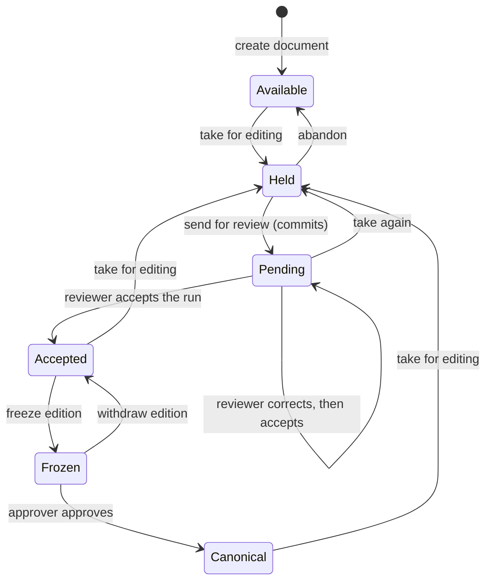
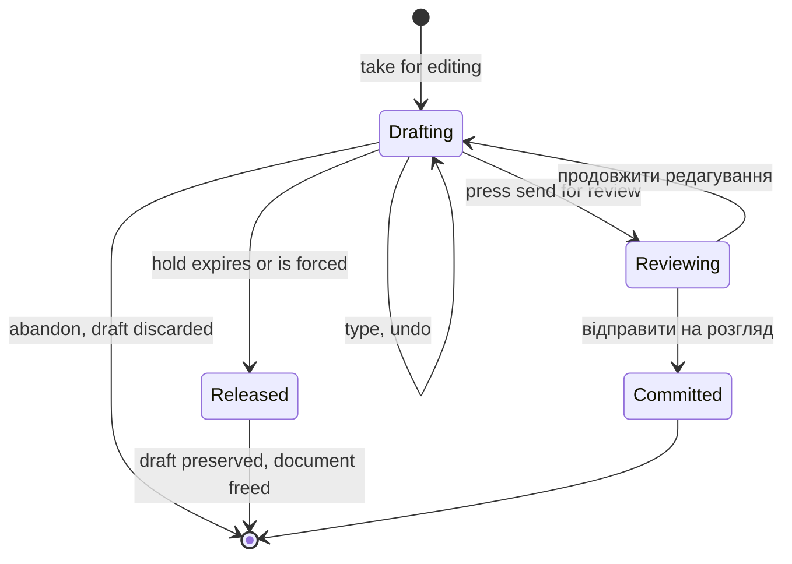
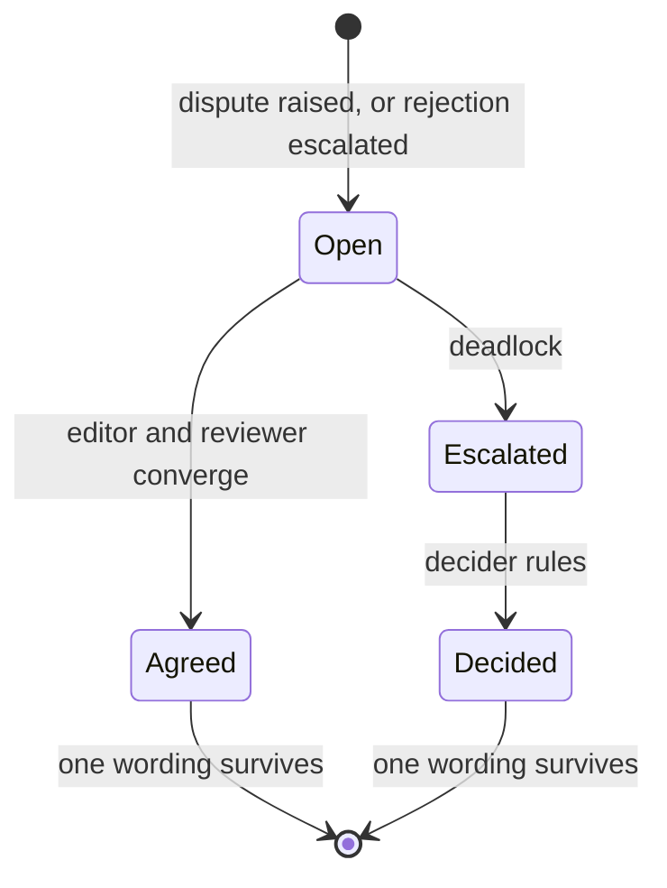

---
tags:
  - technical-design
aliases:
  - Syngraphē document lifecycle
status: draft
date: 2026-09-21
---

# Document Lifecycle — states and the actions that move them

Three diagrams, each small enough to hold in one look. Written against the linear edit model (ADR-0003).

## The document

**Pending** (всі неприйняті правки) means committed but not yet accepted — several editors' versions stack there, each attributed. **My edits in review** (мої правки на розгляді) is the same set filtered to one author; it is a view, not a state, because *send for review* **is** the commit (DL-0054). **Accepted** (прийняті правки) is the last revision a reviewer accepted. **Canonical** (канонічна версія) is the last approved edition — a ref, not a mood, and the document keeps moving past it.

Disputes are stage 2 (DL-0076), so nothing gates `Frozen --> Canonical` in stage 1 but the approver — and, where a tenant has switched it on, the rule that the approver is not whoever performed the last acceptance (DL-0101). The disagreement guard returns with the register.

> [!important] The diagram is one machine over three independent layers
> Canonical edition, accepted baseline and pending versions move **independently** (DL-0106). Read literally the diagram suggests a frozen document cannot be edited until the approver acts, which for a board approval may be weeks. It can: freezing takes a snapshot, it does not close the document. The data model is the authority here — the stances are derived from `ACCEPTANCE` and `EDITION` rows, with no state column for them to disagree with.

## An editing session

There is no Save control. The draft persists server-side so a closed laptop loses nothing, but it is not a version and no one else can see it. Returning the document produces exactly one version, carrying an agent-written summary the editor may edit first.

**Companion actions run at any point**, individually, keyed to the content rather than to a commit (DL-0056). The *Reviewing* state is the send-for-review screen: it shows the analyses for the current content — mostly already computed — and the editor either goes back to editing or commits. Committing writes the analyses into the same commit as the text (DL-0055).

## A disagreement

Entries arrive two ways: a reviewer marks a passage disputed, or an editor escalates a rejection record generated when a reviewer rewrote their wording (ADR-0001). While an entry is open the document holds the latest committed wording and the register holds the competing one.

## Who may do what

| Action | Role | Precondition | Effect |
|---|---|---|---|
| take for editing | editor | document not held | document becomes Held; draft opens |
| call a companion action | the holder, or any editor of the document | this action has not run against this exact content | stored analysis, or one model call; available mid-edit |
| send for review | the holder | draft differs from the current text | the commit; analyses written into it; document becomes Pending |
| abandon | the holder | — | draft discarded; document Available |
| force release | tenant administrator | hold expired or holder unreachable | draft preserved; document freed |

| correct before accepting | reviewer | document Pending | commit touching content and passport; a correction notice generated for every author whose text changed |
| accept the run | reviewer | a reviewer is assigned; versions exist since the last acceptance | commit to the passport; document becomes Accepted; a correction notice goes to every author whose text the reviewer changed |
| return without accepting | reviewer | versions exist since the last acceptance | run stays pending; authors notified with the reviewer's reason (ADR-0001) |
| revert a contribution | reviewer, editor | — | new commit undoing it; never a history rewrite |
| freeze an edition | holder of freeze | — | ref created; document Frozen |
| approve an edition | approver | document Frozen | edition becomes Canonical |
| read | reader | — | sees Canonical; Pending and Accepted require an editing or reviewing role |
| follow a link to another document | any reader | the reader may access the target | otherwise the mention renders as plain text and is absent from *see also* (ASR-16) |
| move a document between folders | editor, tenant administrator | — | metadata only; no repository path changes (ASR-15) |
| set a document's type | tenant administrator | the type exists in the platform table | changes list filtering only |
| toggle show author | anyone who can see a diff | — | attribution shown or hidden (DL-0040) |
