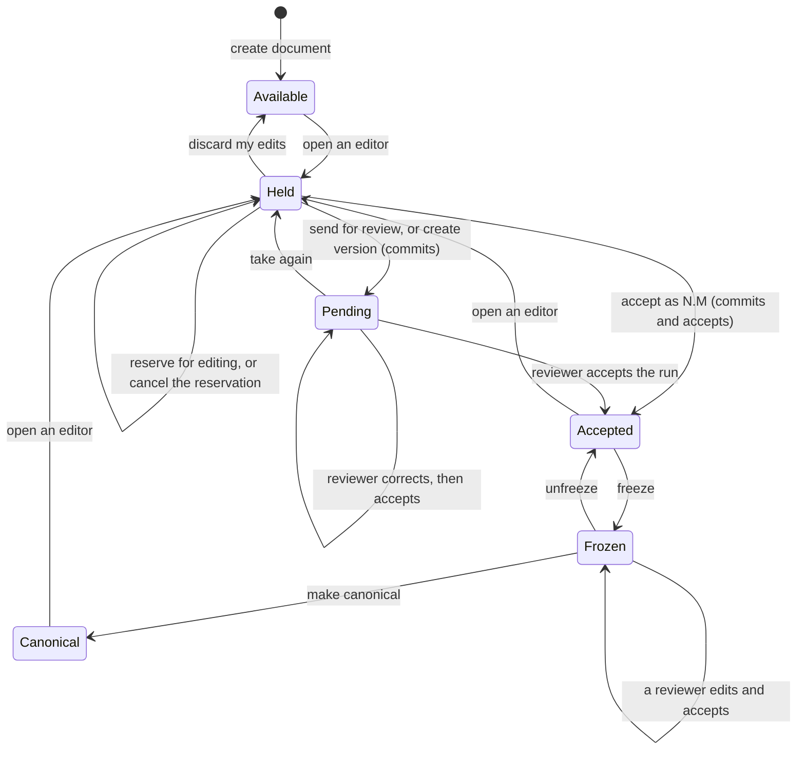
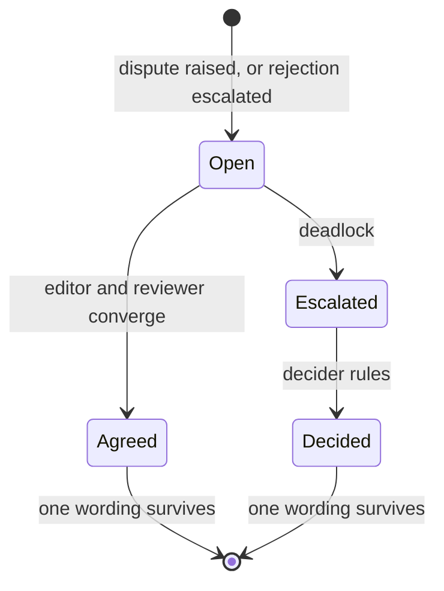

---
tags:
  - technical-design
aliases:
  - Syngraphē document lifecycle
status: draft
date: 2026-09-21
---

# Document Lifecycle — states and the actions that move them

Three diagrams, each small enough to hold in one look. Written against the linear edit model (ADR-0003).

## The document

**Pending** means committed but not yet accepted — several editors' versions stack there, each attributed. **My edits in review** is the same set filtered to one author; it is a view, not a state, because *send for review* **is** the commit (DL-0054). **Accepted edits** is the last revision a reviewer accepted. **Canonical** is the last approved edition — a ref, not a mood, and the document keeps moving past it. The interface names of the stances, in every language, are in [`glossary.md`](glossary.md).

Disputes are stage 2 (DL-0076), so nothing gates `Frozen --> Canonical` in stage 1 but the approver — and, where a tenant has switched it on, the rule that whoever makes it canonical accepted none of the runs since the previous canonical edition (DL-0101, DL-0115). The disagreement guard returns with the register.

> [!important] A freeze locks the document, not a version
> A document is frozen only when nobody holds it. While frozen, editors cannot open an editor; people holding both *accept* and *edit* can, and their commits and acceptances continue the numbering — `1.3-1`, then `1.4` (DL-0189). A frozen document cannot be reserved for editing (DL-0223). No version ever changes. *Make canonical* turns the latest accepted version into the next edition and is refused while commits since it are unaccepted; *unfreeze* returns to ordinary editing at the current number. The stances are derived from `ACCEPTANCE`, `FREEZE` and `EDITION` rows, with no state column for them to disagree with.

## An editing session

```mermaid
stateDiagram-v2
    [*] --> Drafting: open an editor
    Drafting --> Drafting: open and close editors, type, undo, add or change parts
    Drafting --> Reviewing: finish editing, every editor closed
    Reviewing --> Drafting: continue editing, when not reserved
    Reviewing --> Committed: send for review, create version, or accept as N.M
    Reviewing --> [*]: discard my edits, confirmed
    Drafting --> [*]: discard my edits, draft discarded
    Drafting --> Released: inactive past the timeout, or forced
    Drafting --> Reserved: reserve for editing
    Reserved --> Drafting: cancel the reservation
    Reserved --> Reserved: sittings over days or weeks; no inactivity release
    Reserved --> Reviewing: finish editing, every editor closed
    Reserved --> Released: ended by an administrator, with a reason
    Reserved --> [*]: discard my edits, draft discarded
    Reviewing --> Reserved: continue editing, when reserved
    Released --> [*]: draft preserved, document freed
    Committed --> [*]
```

There is no Save control. The draft persists server-side so a closed laptop loses nothing, but it is not a version and no one else can see it. Returning the document produces exactly one version, carrying a change summary the editor writes, starting from a mechanical one; from 0.2 the companion drafts it (DL-0035).

**Editors are views over the one draft** (DL-0167). The holder opens the whole-document editor, or one editor per section — several at once, across tabs if they like — and each captures into the draft over its own range; an editor whose range changed underneath it stops and shows its unsaved text as changes. Adding, replacing, removing, renaming or reordering an appendix or attachment is part of the same draft (DL-0168). Finishing — any of its choices — needs every editor closed.

**A holder may reserve the document for editing** (ADR-0009). The reservation is the same hold with a different release: no inactivity timeout, ended only by finishing, discarding, cancelling, or an administrator breaking the glass with a reason. As for any hold, freezing and link changes wait — but a reserved hold has no inactivity release to end the wait; what is new is that reviewing by anyone else waits too. Others see *reserved for editing, since* a date; holders of *edit* or *accept* on it, and administrators, also see by whom.

**Finishing names its result** (DL-0222). *Finish editing* opens the send-for-review screen for everyone. On it, a holder of *edit* alone commits with *send for review*. A holder of *accept* as well chooses between *accept as N.M* — the version and the acceptance of the whole run in one act — and *create version N.M-X*, which leaves the version pending; each shows the number that results. For a synthetic document accepted at 2.3 with nothing pending, the choices read *accept as 2.4* and *create version 2.3-1*.

**Companion actions run at any point**, individually, keyed to the content rather than to a commit (DL-0056). The *Reviewing* state is the send-for-review screen: it shows the analyses for the current content — mostly already computed — and the editor either goes back to editing or commits. Committing writes the analyses into the same commit as the text (DL-0055).

## A disagreement

Entries arrive two ways: a reviewer marks a passage disputed, or an editor escalates a rejection record generated when a reviewer rewrote their wording (ADR-0001). While an entry is open the document holds the latest committed wording and the register holds the competing one.

## Who may do what

| Action | Role | Precondition | Effect |
|---|---|---|---|
| open an editor | editor | document not held, or held by this user | takes the hold if free; draft opens (ADR-0006) |
| call a companion action | the holder, or any editor of the document | this action has not run against this exact content | stored analysis, or one model call; available during a hold once every editor is closed (ADR-0006) |
| open an editor — whole document, or one per section | the holder | the whole-document editor needs no section editor open | captures into the draft over its range (DL-0167) |
| add, replace, remove, rename or reorder an appendix or attachment | the holder | an attachment within the tenant's size cap | staged in the draft; committed with the text (DL-0168, DL-0175) |
| send for review — *create version N.M-X* for a holder of accept | the holder | draft differs from the current text or stages a file operation; no editor open | the commit; analyses written into it; document becomes Pending; a reservation ends |
| accept as N.M | the holder, holding accept | as *send for review* | the commit and the acceptance of the whole run since the last one, in one act, allowed while the holder's own reservation is set; correction notices as at acceptance; document becomes Accepted; a reservation ends (DL-0222) |
| reserve for editing | the holder, holding *reserve for editing* | holds the document; not frozen | the hold is exempt from the inactivity release; the tenant administrator is notified (ADR-0009) |
| cancel the reservation | the holder | reserved | back to an ordinary hold; the inactivity clock restarts |
| discard my edits | the holder | confirmed | draft discarded, staged file operations included; document Available |
| force release | tenant administrator | holder inactive or unreachable; not reserved | draft preserved; document freed |
| end a reservation | tenant or platform administrator | reserved; a reason given | draft preserved; document freed; the holder notified with who, when and why; an audit event (DL-0225) |
| correct before accepting | reviewer | document Pending, not reserved | commit touching content and passport, including reverting an appendix or attachment operation; a correction notice generated for every author whose text changed |
| accept the run | reviewer | a reviewer is assigned; versions exist since the last acceptance; not reserved | commit to the passport; document becomes Accepted; a correction notice goes to every author whose text the reviewer changed |
| return without accepting | reviewer | versions exist since the last acceptance; not reserved | run stays pending; authors notified with the reviewer's reason (ADR-0001) |
| revert a contribution | reviewer | versions exist since the last acceptance; not reserved; nobody else holds the document | the reversal of one version, or of one author's versions in the run, applied to the reviewer's draft where it reverts cleanly; sentences a later version changed are listed for editing by hand; committed when the reviewer finishes, with correction notices; never a history rewrite (DL-0243) |
| freeze | holder of freeze | document not frozen, and nobody holds it | document Frozen; editors locked out, holders of *accept* and *edit* may still edit (DL-0189) |
| unfreeze | holder of freeze | document Frozen | ordinary editing resumes at the current accepted number |
| make canonical | holder of make canonical, which includes the accepted view (DL-0234) | document Frozen; no unaccepted commits since the latest acceptance | latest accepted version becomes the next edition, `N+1.0`; freeze ends |
| read | holder of a viewing right | — | *view canonical* sees Canonical; *view accepted* adds Accepted; *view pending* adds Pending; history rights add earlier versions (ADR-0007) |
| follow a link to another document | any reader | the reader may access the target | otherwise the mention renders as plain text and is absent from *see also* (ASR-16) |
| move a document between folders | tenant administrator | — | metadata only; no repository path changes, no access change (ASR-15) |
| copy a document | holder of create and edit | may see the chosen version | new author-only document with that text, chosen appendices, no attachments, no history (ADR-0007) |
| set a document's type | tenant administrator | the type is on the organisation's list (DL-0235) | changes list filtering only |
| toggle show author | anyone who can see a diff | — | attribution shown or hidden (DL-0040) |
| download an attachment | anyone who may read the version it belongs to | — | the stored file, under its original name |
| export | anyone who may read the chosen view | at least one scope and one format chosen | an export job (DL-0172) |
| edit the document template | tenant administrator | — | applies to documents created afterwards (DL-0169) |
