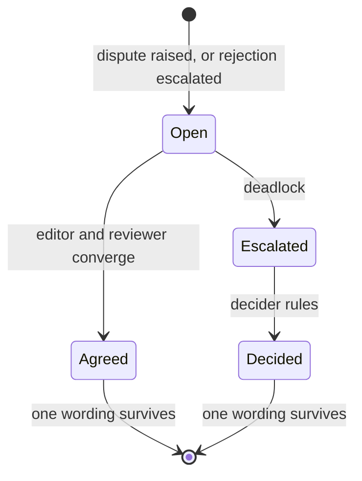

---
tags:
  - technical-design
aliases:
  - Syngraphē document lifecycle
status: active
date: 2026-09-21
---

# Document Lifecycle — states and the actions that move them

Three diagrams, each small enough to hold in one look. Written against the linear edit model (ADR-0003).

## The document

```mermaid
stateDiagram-v2
    [*] --> Available: create document
    Available --> Held: edit, which opens the editor (DL-0319, DL-0517)
    Held --> Held: reserve for editing, or cancel the reservation
    Held --> Available: discard my edits, or release the document with nothing edited (DL-0510)
    Held --> Pending: send for review, or create version (commits)
    Held --> Accepted: accept as N.M (commits and accepts)
    Held --> Available: released — inactivity, forced, a reservation ended by an administrator, or the holder blocked; a draft with edits kept (DL-0514), unless a stopped finish is completed instead (DL-0414)
    Pending --> Held: edit again; a holder of accept changes or undoes the run in their own draft (DL-0521)
    Pending --> Accepted: reviewer accepts the run
    Pending --> Pending: reviewer returns the run, with a reason
    Pending --> Frozen: freeze
    Accepted --> Held: edit
    Accepted --> Frozen: freeze
    Accepted --> Canonical: make canonical (DL-0515)
    Frozen --> Frozen: a holder of accept edits and accepts
    Frozen --> Accepted: unfreeze
    Frozen --> Pending: unfreeze, versions still pending
    Held --> Pending: discard my edits, release the document, or released — versions still pending
    Frozen --> Canonical: make canonical
    Canonical --> Held: edit
```

**Pending** means committed but not yet accepted — several editors' versions stack there, each attributed. **My edits in review** is the same set filtered to one author — release 0.1 does not draw it (DL-0549); it is a view, not a state, because *send for review* **is** the commit (DL-0054). **Accepted edits** is the last revision a reviewer accepted. **Canonical** is the last approved edition — a ref, not a mood, and the document keeps moving past it. The interface names of the stances, in every language, are in [`glossary.md`](glossary.md).

Disputes are stage 2 (DL-0076), so nothing gates *make canonical* — `Accepted --> Canonical` or `Frozen --> Canonical` — in stage 1 but the approver — and, where a tenant has switched it on, the rule that whoever makes it canonical accepted none of the runs since the previous canonical edition (DL-0101, DL-0115). The disagreement guard returns with the register.

> [!important] A freeze locks the document, not a version
> A document is frozen only when nobody holds it. While frozen, editors cannot open the editor; holders of *accept* can (ADR-0016), and their commits and acceptances continue the numbering — `1.3-1`, then `1.4` (DL-0189). A frozen document cannot be reserved for editing (DL-0223). No version ever changes. *Make canonical* turns the latest accepted version into the next edition whether or not the document is frozen (DL-0515), while nobody holds it (DL-0419), and is refused while content versions since that acceptance are unaccepted (DL-0267); a freeze ends with it, or by *unfreeze*, which returns to ordinary editing at the current number. The stances are derived from `ACCEPTANCE`, `FREEZE` and `EDITION` rows, with no state column for them to disagree with.

## An editing session

```mermaid
stateDiagram-v2
    [*] --> Drafting: edit, which opens the whole document's editor (DL-0319, DL-0517)
    Drafting --> Drafting: type, undo, add or change parts; leave for another point of the path and come back, the draft and the hold kept (DL-0518)
    Drafting --> Reviewing: finish editing, once there is an edit
    Reviewing --> Drafting: continue editing, when not reserved
    Reviewing --> Committed: send for review, create version, or accept as N.M
    Reviewing --> [*]: discard my edits, confirmed in a window (DL-0513)
    Drafting --> [*]: release the document with nothing edited, no confirmation (DL-0510); or discard my edits, confirmed in a window (DL-0513)
    Drafting --> Prompted: idle past the organisation's timeout
    Prompted --> Drafting: I am still working, or typing
    Prompted --> Released: still idle ten minutes later (DL-0377)
    Drafting --> Released: forced, or the holder blocked
    Drafting --> Reserved: reserve for editing
    Reserved --> Drafting: cancel the reservation
    Reserved --> Reserved: sittings over days or weeks; no inactivity release
    Reserved --> Reviewing: finish editing, once there is an edit
    Reserved --> Released: ended by an administrator with a reason, or the holder blocked
    Reserved --> [*]: release the document with nothing edited, confirmed because the reservation ends (DL-0510); or discard my edits, confirmed
    Reviewing --> Reserved: continue editing, when reserved
    Released --> [*]: a draft with edits kept, nothing kept with none (DL-0514); document freed — unless a stopped finish is completed instead (DL-0414)
    Committed --> [*]
```

There is no Save control. The draft persists server-side so a closed laptop loses nothing, but it is not a version and no one else can see it. Finishing produces exactly one version, carrying a change summary the editor writes, starting from a mechanical one that names the sections touched (DL-0261); from 0.2 the companion drafts it (DL-0039, DL-0261).

**The editor is a view over the one draft** (ADR-0006, DL-0517). *Edit* opens the whole document's editor on the draft — a document is shown either to be read or to be edited, and there is no editor over one section — and the editor captures into the draft; an editor whose draft changed underneath it, from another window of the holder's, stops and shows its unsaved text as changes. The editor is as wide as the document's text reads (DL-0513), and *my edits*, the draft's changes marked in place, is a switch inside it (DL-0518). Adding, replacing, removing, renaming or reordering an appendix or attachment is part of the same draft (DL-0168). Finishing — any of its choices — needs an edit: a hold with none — no captured text, no part operation, no title page change — is let go with *release the document* instead of *discard my edits*, without confirmation unless a reservation ends with it (DL-0510).

**A quiet hold is asked before it is released** (ADR-0006, DL-0377). A hold idle past the organisation's timeout, and not reserved, asks its holder *are you still working?* in the editor and once by notification — a holder away from the editor, on another point of the path, is asked by the notification alone; an answer, or typing, restarts the clock; still idle ten minutes later, it is released for inactivity, the draft kept. **The draft kept by any release** — inactivity, forced, a reservation ended, a block — is offered back on the holder's return: taken back while the document has not changed since the draft began — no new version and no acceptance, the head unmoved (DL-0318) — otherwise shown read-only to be discarded (DL-0225, DL-0381). A hold with no edits keeps nothing when it ends: no draft offered back, nothing to discard (DL-0514).

**Whoever holds the document is named to those it blocks** (DL-0516). For every hold, ordinary or reserved, holders of *edit* or *accept* on the document, and administrators, see who holds it — under the latest version, and as the reason beside the disabled *edit*; everyone else who may read the document sees the fact alone.

**A holder may reserve the document for editing** (ADR-0009). The reservation is the same hold with a different release: no inactivity timeout, ended only by finishing, discarding, releasing with nothing edited, cancelling, an administrator breaking the glass with a reason, or a block of the holder (DL-0256). As for any hold, freezing and link changes wait — but a reserved hold has no inactivity release to end the wait; what is new is that reviewing by anyone else waits too. Others see *reserved for editing, since* a date; holders of *edit* or *accept* on it, and administrators, also see by whom.

**Finishing names its result** (DL-0222). *Finish editing* opens the send-for-review screen for everyone. On it, a holder of *edit* without *accept* commits with *send for review*. A holder of *accept*, which includes *edit* (ADR-0016), chooses between *accept as N.M* — the version and the acceptance of the whole run in one act — and *create version N.M-X*, which leaves the version pending; each shows the number that results. For a synthetic document accepted at 2.3 with nothing pending, the choices read *accept as 2.4* and *create version 2.3-1*. A holder of *accept* who changes a pending run — what they will not accept as it stands — edits as any holder does, with no act of its own (DL-0521): their version is marked as committed by a holder of *accept*, and the correction notices go out at the acceptance that makes it authoritative (ADR-0014).

**Companion actions run at any point**, individually, keyed to the content rather than to a commit (DL-0056). The *Reviewing* state is the send-for-review screen. In release 0.1 it shows the holder's changes, the part operations and the change summary, and nothing else (DL-0261); from 0.2 it shows the companion analyses for the current content as well — mostly already computed — and committing writes them into the same commit as the text (DL-0055). The editor either goes back to editing or commits.

## A disagreement — stage 2 (DL-0076)



Entries arrive two ways: a reviewer marks a passage disputed, or an editor escalates a rejection record generated when a reviewer rewrote their wording (ADR-0001). While an entry is open the document holds the latest committed wording and the register holds the competing one.

## Who may do what

| Action | Role | Precondition | Effect |
|---|---|---|---|
| edit — open the editor | holder of *edit* — *accept*, *freeze* and *reserve for editing* include it (ADR-0016) | document not held, or held by this user — while someone else holds it, the control is disabled naming the holder to holders of *edit* or *accept* and to administrators (DL-0516); if frozen, the user holds *accept* | takes the hold if free; the whole document's editor opens on the draft and captures into it — there is no section editor (ADR-0006, DL-0167, DL-0517); on a pending run a holder of *accept* changes in their own draft what they will not accept as it stands — reverting an appendix or attachment operation of the run included, which needs *accept* alone (DL-0446) — and finishes with *accept as N.M* or *create version N.M-X* (DL-0222, DL-0521); that version is marked as committed by a holder of *accept*, and correction notices go out at the acceptance that makes it authoritative (ADR-0014) |
| call a companion action — from stage 2 | the holder, or any editor of the document | this action has not run against this exact content | stored analysis, or one model call; available during a hold, outside the editor (ADR-0006) |
| add, replace, remove, rename or reorder an appendix or attachment | the holder, with the part right: *create appendix*, *delete appendix*, *upload attachment*, *replace attachment*, *delete attachment* — renaming and reordering *edit* alone; a part the draft added withdrawn with the right that added it; the author of a document no group is linked to may upload and replace attachments (DL-0445) | an attachment within the tenant's size cap; no editor open on an appendix being deleted | staged in the draft; committed with the text, the part rights decided again at the commit (DL-0168, DL-0175) |
| switch the title page, or write its text | the holder | holds the document; the text plain, at most 500 characters and 8 lines, no control, reordering or invisible format character but the two joiners some scripts need (DL-0476, DL-0483) | a draft change, listed among the run's changes for the reviewer and committed with the run; a run of it alone is a version; an undo keeps it, as it keeps a title (DL-0463) |
| send for review — *create version N.M-X* for a holder of accept | the holder | draft differs from the current text or stages a file operation — with no edit, the hold is let go with *release the document* instead (DL-0510) | the commit — analyses written into it from release 0.2; document becomes Pending; a reservation ends |
| accept as N.M | the holder, holding accept | as *send for review* | the commit — a version committed by a holder of *accept* — and the acceptance of the whole run since the last one, in one act, allowed while the holder's own reservation is set; correction notices at the acceptance (ADR-0014); document becomes Accepted; a reservation ends (DL-0222) |
| reserve for editing | the holder, holding *reserve for editing* | holds the document; not frozen | the hold is exempt from the inactivity release; the tenant administrator is notified (ADR-0009) |
| cancel the reservation | the holder | reserved | back to an ordinary hold; the inactivity clock restarts |
| discard my edits | the holder | after the first edit; confirmed in a window over the page, from the editor, the send-for-review screen or a kept draft (DL-0510, DL-0513) | draft discarded, staged file operations included; a reservation ends with it; document Available — a version a stopped finish already made stands and is told to the reviewers |
| release the document | the holder | nothing edited — no captured text, no part operation, no title page change; without confirmation, unless a reservation ends with it (DL-0510) | the hold ends and nothing is kept (DL-0514); a reservation ends with it; document Available, or Pending while versions are pending |
| take the document back | the holder of a kept draft | nobody has committed since the draft began | the hold taken again with the kept draft (DL-0318) |
| discard this draft | the holder of a kept draft | confirmed | the kept draft and its files deleted (DL-0381) |
| force release | tenant or platform administrator, not the holder | not reserved; for a holder inactive or unreachable | a draft with edits kept, nothing with none (DL-0514) — unless a stopped finish is completed instead (DL-0414); document freed |
| end a reservation | tenant or platform administrator, not the holder | reserved; a reason given, on a page naming the reservation (DL-0415) | a draft with edits kept, nothing with none (DL-0514) — unless a stopped finish is completed instead, its reason audited with it (DL-0414); document freed; the holder notified with who, when and why — the reason in the application, never by email (DL-0369); an audit event (DL-0225) |
| block a person | tenant administrator (a membership), the person (their account), platform administrator (a tenant) | — | every hold and reservation of the person on the documents the block closes to them is released; drafts with edits kept (DL-0514), unless a stopped finish is completed instead (DL-0414); an audit event naming the block (DL-0256) |
| accept the run | reviewer | a reviewer is assigned; versions exist since the last acceptance; not reserved; no undo or revert of the run waits in an open draft — that draft's *accept as* accepts it (DL-0427) | commit to the passport; document becomes Accepted; one correction notice per author whose lines of the run — the body's or an appendix's — a version committed by a holder of *accept*, or by the acceptor, replaced or removed, or whose removal it undid, or whose appendix or attachment operation it reversed (ADR-0014) |
| return without accepting | reviewer | versions exist since the last acceptance; not reserved; not returned already with nothing sent since; a reason, one line of at most 500 characters (DL-0378) | a passport commit (DL-0114) and its `RETURN` row; run stays pending, shown as *returned* until a version is sent after it, and out of *In review* meanwhile (DL-0420); authors notified, the reason read in the application, never in the email (DL-0369) |
| undo a contribution — *undo this edit*, *undo all of this author's edits* | reviewer | versions exist since the last acceptance that change text; not reserved; nobody else holds the document; no kept draft of the reviewer's waits; not undone into the draft already | the reversal of one version, or of one author's versions in the run — the body of `document.md` and each appendix the run touched, a title or part operation, an appendix the undone versions created or deleted among them, listed to be reverted with the parts' own controls (DL-0447) — merged into the reviewer's draft where it reverts cleanly (DL-0425); what a later version or the draft changed is left and listed beside the text for editing by hand (DL-0380), except a line a later version deleted, or rewrote and a later one deleted (DL-0422); committed when the reviewer finishes; correction notices at the acceptance (ADR-0014); never a history rewrite (ADR-0015) |
| freeze | holder of *freeze and unfreeze*, which includes *edit* (ADR-0016) | document not frozen, and nobody holds it | document Frozen; editors locked out, holders of *accept* may still edit (DL-0189, ADR-0016) |
| unfreeze | holder of *freeze and unfreeze* | document Frozen, and nobody holds it (DL-0416) | the freeze ends with its actor, no reason asked; ordinary editing resumes at the current accepted number |
| make canonical | holder of make canonical, which includes the accepted view (DL-0234) | document Accepted or Frozen — a freeze is not required (DL-0515); nobody holds it (DL-0419); an acceptance since the previous edition; no unaccepted content version since the latest acceptance (DL-0267); where the tenant has switched it on, the approver accepted none of the runs since the previous edition (DL-0115); confirmed in a window naming the version, the edition it becomes and that it cannot be undone (DL-0513) | latest accepted version becomes the next edition, `N+1.0`, by a passport commit that is tagged (DL-0260); a freeze, where one stands, ends |
| read | holder of a viewing right | — | *view canonical* sees Canonical; *view accepted* adds Accepted; *view pending* adds Pending; history rights add earlier versions (ADR-0007) |
| follow a link to another document | any reader | the reader may access the target | otherwise the mention renders as plain text, and *see also* lists it as plain text (ASR-16, DL-0071, DL-0437) |
| move a document between folders | tenant administrator | — | metadata only; no repository path changes, no access change (ASR-15) |
| copy a document | holder of create and edit | may see the chosen version | new author-only document with that text, chosen appendices, no attachments, no history (ADR-0007) |
| archive | tenant administrator | the document is active | off every list and search; mentions of it render as plain text for everyone; a hold is released as a force release does and a reservation ended, drafts with edits kept, the reason the platform's own — the holder is told by a notification naming the number and the archiver, never the title, and the kept draft says the editing ended when the document was archived (DL-0456, DL-0471); a freeze and a pending run kept as they stand; administrators open its read-only pages with an *archived* tag, every act refused (DL-0084, DL-0449, DL-0450) |
| restore | tenant administrator | the document is archived | active again exactly as it was; its group links apply as they stand; a kept draft is offered back to its holder as after any forced release, while nobody has committed since (DL-0084, DL-0318) |
| set a document's type | tenant administrator | the type is on the organisation's list (DL-0235) | changes list filtering only |
| tick *Show edit authors* | anyone who can see a comparison | — | the checkbox at the top of the names' column, as its title; the preference saved and the page drawn again, each changed paragraph naming its edit author in the right margin, an unchanged one nothing (DL-0040, DL-0504) |
| download an attachment | anyone who may read the version it belongs to | — | the stored file, under its original name |
| export | anyone who may read the chosen view | at least one scope and one format chosen | an export job (DL-0172) |
| edit the document template | tenant administrator | — | applies to documents created afterwards (DL-0169) |
| set the title page layout | tenant administrator | no two shown details at one position | applies to every export of a document whose title page is on; the approval line always shown (DL-0462, DL-0475) |
| edit the stylesheet | tenant administrator | every line within the allowlist, each refusal named by its line (DL-0464) | applies at once to every reading and every later export of the organisation's documents; audited with its whole text (DL-0465, DL-0477) |
| export a sample of the stylesheet | tenant administrator | no sample of the organisation queued or running | a PDF or Word file of an invented text with the stylesheet in the box, never applied; kept for a day (DL-0466) |
