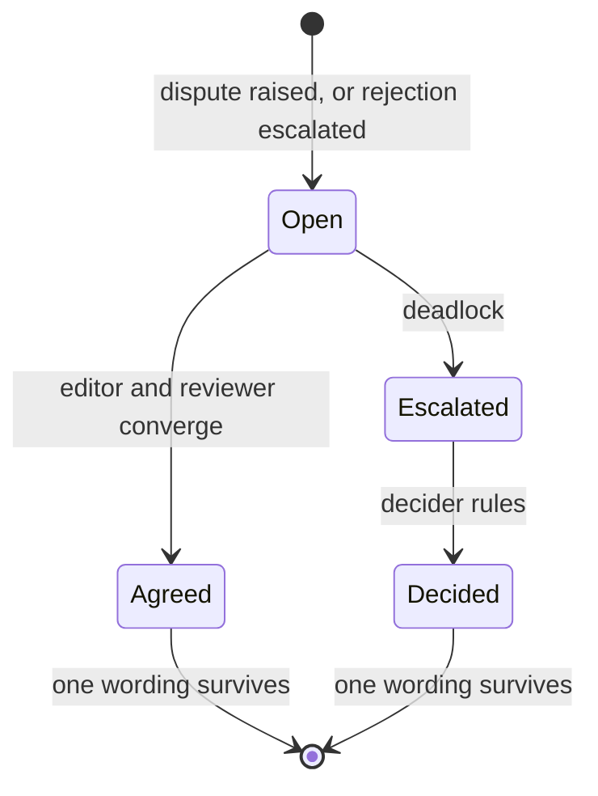

---
tags:
  - technical-design
aliases:
  - Syngraphē document lifecycle
status: draft
date: 2026-09-21
---

# Document Lifecycle — states and the actions that move them

Three diagrams, each small enough to hold in one look. Written against the linear edit model (ADR-0003).

## The document

```mermaid
stateDiagram-v2
    [*] --> Available: create document
    Available --> Held: open the edit tab (DL-0319)
    Held --> Held: reserve for editing, or cancel the reservation
    Held --> Available: discard my edits
    Held --> Pending: send for review, or create version (commits)
    Held --> Accepted: accept as N.M (commits and accepts)
    Held --> Available: released — inactivity, forced, a reservation ended by an administrator, or the holder blocked; draft kept, unless a stopped finish is completed instead (DL-0414)
    Pending --> Held: take again; a reviewer corrects or undoes in their own draft
    Pending --> Accepted: reviewer accepts the run
    Pending --> Pending: reviewer returns the run, with a reason
    Pending --> Frozen: freeze
    Accepted --> Held: open an editor
    Accepted --> Frozen: freeze
    Frozen --> Frozen: a holder of accept edits and accepts
    Frozen --> Accepted: unfreeze
    Frozen --> Pending: unfreeze, versions still pending
    Held --> Pending: discard my edits or released, versions still pending
    Frozen --> Canonical: make canonical
    Canonical --> Held: open an editor
```

**Pending** means committed but not yet accepted — several editors' versions stack there, each attributed. **My edits in review** is the same set filtered to one author; it is a view, not a state, because *send for review* **is** the commit (DL-0054). **Accepted edits** is the last revision a reviewer accepted. **Canonical** is the last approved edition — a ref, not a mood, and the document keeps moving past it. The interface names of the stances, in every language, are in [`glossary.md`](glossary.md).

Disputes are stage 2 (DL-0076), so nothing gates `Frozen --> Canonical` in stage 1 but the approver — and, where a tenant has switched it on, the rule that whoever makes it canonical accepted none of the runs since the previous canonical edition (DL-0101, DL-0115). The disagreement guard returns with the register.

> [!important] A freeze locks the document, not a version
> A document is frozen only when nobody holds it. While frozen, editors cannot open an editor; holders of *accept* can (ADR-0016), and their commits and acceptances continue the numbering — `1.3-1`, then `1.4` (DL-0189). A frozen document cannot be reserved for editing (DL-0223). No version ever changes. *Make canonical* turns the latest accepted version into the next edition and is refused while content versions since it are unaccepted (DL-0267); *unfreeze* returns to ordinary editing at the current number. The stances are derived from `ACCEPTANCE`, `FREEZE` and `EDITION` rows, with no state column for them to disagree with.

## An editing session

```mermaid
stateDiagram-v2
    [*] --> Drafting: open the edit tab (DL-0319)
    Drafting --> Drafting: open and close editors, type, undo, add or change parts
    Drafting --> Reviewing: finish editing, every editor closed
    Reviewing --> Drafting: continue editing, when not reserved
    Reviewing --> Committed: send for review, create version, or accept as N.M
    Reviewing --> [*]: discard my edits, confirmed
    Drafting --> [*]: discard my edits, draft discarded
    Drafting --> Prompted: idle past the organisation's timeout
    Prompted --> Drafting: I am still working, or typing
    Prompted --> Released: still idle ten minutes later (DL-0377)
    Drafting --> Released: forced, or the holder blocked
    Drafting --> Reserved: reserve for editing
    Reserved --> Drafting: cancel the reservation
    Reserved --> Reserved: sittings over days or weeks; no inactivity release
    Reserved --> Reviewing: finish editing, every editor closed
    Reserved --> Released: ended by an administrator with a reason, or the holder blocked
    Reserved --> [*]: discard my edits, draft discarded
    Reviewing --> Reserved: continue editing, when reserved
    Released --> [*]: draft kept, document freed — unless a stopped finish is completed instead (DL-0414)
    Committed --> [*]
```



There is no Save control. The draft persists server-side so a closed laptop loses nothing, but it is not a version and no one else can see it. Finishing produces exactly one version, carrying a change summary the editor writes, starting from a mechanical one that names the sections touched (DL-0261); from 0.2 the companion drafts it (DL-0035).

**Editors are views over the one draft** (ADR-0006). The edit tab opens on the draft as text; the holder opens the whole-document editor, or one editor per section — several at once, across tabs if they like — and each captures into the draft over its own range; an editor whose range changed underneath it stops and shows its unsaved text as changes. A heading typed into a section editor becomes a section of its own once that editor is closed. Adding, replacing, removing, renaming or reordering an appendix or attachment is part of the same draft (DL-0168). Finishing — any of its choices — needs every editor closed.

**A quiet hold is asked before it is released** (ADR-0006, DL-0377). A hold idle past the organisation's timeout, and not reserved, asks its holder *are you still working?* in an open editor and once by notification — a tab with no editor open is asked by the notification alone; an answer, or typing, restarts the clock; still idle ten minutes later, it is released for inactivity, the draft kept. **The draft kept by any release** — inactivity, forced, a reservation ended, a block — is offered back on the holder's return: taken back while the document has not changed since the draft began — no new version and no acceptance, the head unmoved (DL-0318) — otherwise shown read-only to be discarded (DL-0225, DL-0381).

**A holder may reserve the document for editing** (ADR-0009). The reservation is the same hold with a different release: no inactivity timeout, ended only by finishing, discarding, cancelling, an administrator breaking the glass with a reason, or a block of the holder (DL-0256). As for any hold, freezing and link changes wait — but a reserved hold has no inactivity release to end the wait; what is new is that reviewing by anyone else waits too. Others see *reserved for editing, since* a date; holders of *edit* or *accept* on it, and administrators, also see by whom.

**Finishing names its result** (DL-0222). *Finish editing* opens the send-for-review screen for everyone. On it, a holder of *edit* without *accept* commits with *send for review*. A holder of *accept*, which includes *edit* (ADR-0016), chooses between *accept as N.M* — the version and the acceptance of the whole run in one act — and *create version N.M-X*, which leaves the version pending; each shows the number that results. For a synthetic document accepted at 2.3 with nothing pending, the choices read *accept as 2.4* and *create version 2.3-1*.

**Companion actions run at any point**, individually, keyed to the content rather than to a commit (DL-0056). The *Reviewing* state is the send-for-review screen. In release 0.1 it shows the holder's changes, the part operations and the change summary, and nothing else (DL-0261); from 0.2 it shows the companion analyses for the current content as well — mostly already computed — and committing writes them into the same commit as the text (DL-0055). The editor either goes back to editing or commits.

## A disagreement



Entries arrive two ways: a reviewer marks a passage disputed, or an editor escalates a rejection record generated when a reviewer rewrote their wording (ADR-0001). While an entry is open the document holds the latest committed wording and the register holds the competing one.

## Who may do what

| Action | Role | Precondition | Effect |
|---|---|---|---|
| open an editor | holder of *edit* — *accept*, *freeze* and *reserve for editing* include it (ADR-0016) | document not held, or held by this user; if frozen, the user holds *accept* | takes the hold if free; draft opens (ADR-0006) |
| call a companion action | the holder, or any editor of the document | this action has not run against this exact content | stored analysis, or one model call; available during a hold once every editor is closed (ADR-0006) |
| open an editor — whole document, or one per section | the holder | the whole-document editor needs no section editor open | captures into the draft over its range (DL-0167) |
| add, replace, remove, rename or reorder an appendix or attachment | the holder | an attachment within the tenant's size cap | staged in the draft; committed with the text (DL-0168, DL-0175) |
| send for review — *create version N.M-X* for a holder of accept | the holder | draft differs from the current text or stages a file operation; no editor open | the commit — analyses written into it from release 0.2; document becomes Pending; a reservation ends |
| accept as N.M | the holder, holding accept | as *send for review* | the commit — a version committed by a holder of *accept* — and the acceptance of the whole run since the last one, in one act, allowed while the holder's own reservation is set; correction notices at the acceptance (ADR-0014); document becomes Accepted; a reservation ends (DL-0222) |
| reserve for editing | the holder, holding *reserve for editing* | holds the document; not frozen | the hold is exempt from the inactivity release; the tenant administrator is notified (ADR-0009) |
| cancel the reservation | the holder | reserved | back to an ordinary hold; the inactivity clock restarts |
| discard my edits | the holder | confirmed; no editor open | draft discarded, staged file operations included; a reservation ends with it; document Available — a version a stopped finish already made stands and is told to the reviewers |
| take the document back | the holder of a kept draft | nobody has committed since the draft began | the hold taken again with the kept draft (DL-0318) |
| discard this draft | the holder of a kept draft | confirmed | the kept draft and its files deleted (DL-0381) |
| force release | tenant or platform administrator, not the holder | not reserved; for a holder inactive or unreachable | draft kept — unless a stopped finish is completed instead (DL-0414); document freed |
| end a reservation | tenant or platform administrator, not the holder | reserved; a reason given, on a page naming the reservation (DL-0415) | draft kept — unless a stopped finish is completed instead, its reason audited with it (DL-0414); document freed; the holder notified with who, when and why — the reason in the application, never by email (DL-0369); an audit event (DL-0225) |
| block a person | tenant administrator (a membership), the person (their account), platform administrator (a tenant) | — | every hold and reservation of the person on the documents the block closes to them is released; drafts kept, unless a stopped finish is completed instead (DL-0414); an audit event naming the block (DL-0256) |
| correct before accepting | reviewer (holder of *accept*) | document Pending; nobody holds it | takes the hold; the reviewer edits in their own draft — reverting an appendix or attachment operation included — and finishes with *accept as N.M* or *create version N.M-X* (DL-0222); the version is marked as committed by a holder of *accept*, and correction notices go out at the acceptance that makes it authoritative (ADR-0014) |
| accept the run | reviewer | a reviewer is assigned; versions exist since the last acceptance; not reserved | commit to the passport; document becomes Accepted; one correction notice per author whose lines of the run a version committed by a holder of *accept*, or by the acceptor, replaced or removed, or whose removal it undid (ADR-0014) |
| return without accepting | reviewer | versions exist since the last acceptance; not reserved | a passport commit (DL-0114); run stays pending, shown as *returned*; authors notified with the reviewer's reason (ADR-0001) |
| undo a contribution — *undo this edit*, *undo all of this author's edits* | reviewer | versions exist since the last acceptance; not reserved; nobody else holds the document | the reversal of one version, or of one author's versions in the run, applied to the reviewer's draft where it reverts cleanly; sentences a later version changed are listed for editing by hand; committed when the reviewer finishes; correction notices at the acceptance (ADR-0014); never a history rewrite (ADR-0015) |
| freeze | holder of *freeze and unfreeze*, which includes *edit* (ADR-0016) | document not frozen, and nobody holds it | document Frozen; editors locked out, holders of *accept* may still edit (DL-0189, ADR-0016) |
| unfreeze | holder of *freeze and unfreeze* | document Frozen, and nobody holds it (DL-0416) | the freeze ends with its actor, no reason asked; ordinary editing resumes at the current accepted number |
| make canonical | holder of make canonical, which includes the accepted view (DL-0234) | document Frozen; nobody holds it (DL-0419); an acceptance since the previous edition; no unaccepted content version since the latest acceptance (DL-0267); where the tenant has switched it on, the approver accepted none of the runs since the previous edition (DL-0115) | latest accepted version becomes the next edition, `N+1.0`, by a passport commit that is tagged (DL-0260); freeze ends |
| read | holder of a viewing right | — | *view canonical* sees Canonical; *view accepted* adds Accepted; *view pending* adds Pending; history rights add earlier versions (ADR-0007) |
| follow a link to another document | any reader | the reader may access the target | otherwise the mention renders as plain text and is absent from *see also* (ASR-16) |
| move a document between folders | tenant administrator | — | metadata only; no repository path changes, no access change (ASR-15) |
| copy a document | holder of create and edit | may see the chosen version | new author-only document with that text, chosen appendices, no attachments, no history (ADR-0007) |
| set a document's type | tenant administrator | the type is on the organisation's list (DL-0235) | changes list filtering only |
| toggle show author | anyone who can see a diff | — | attribution shown or hidden (DL-0040) |
| download an attachment | anyone who may read the version it belongs to | — | the stored file, under its original name |
| export | anyone who may read the chosen view | at least one scope and one format chosen | an export job (DL-0172) |
| edit the document template | tenant administrator | — | applies to documents created afterwards (DL-0169) |
